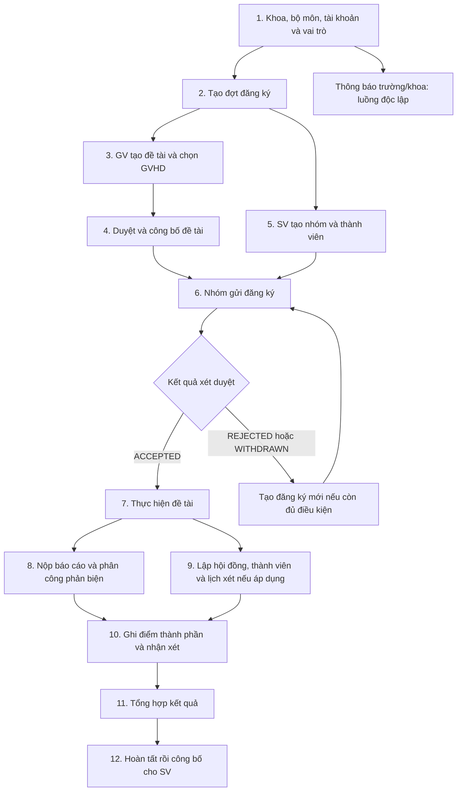
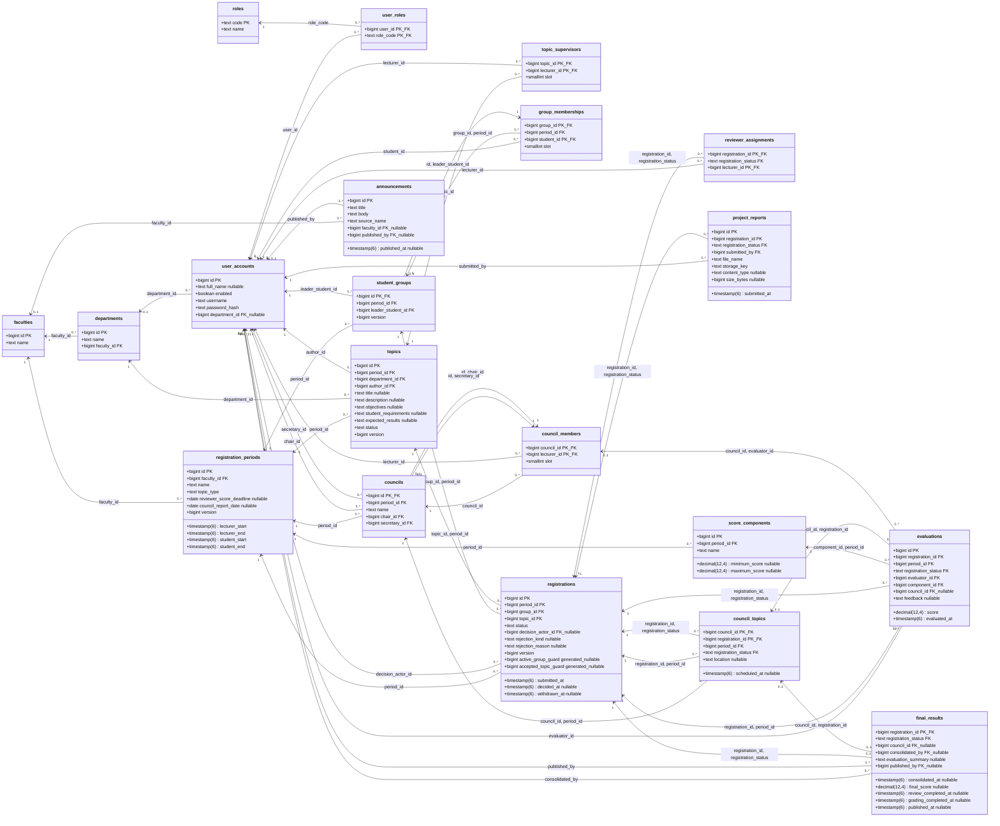

# Luồng dữ liệu và class diagram — 20 bảng

Đối chiếu `V1__full_system.sql`. Đây là luồng nghiệp vụ dự kiến trên cấu trúc SQL hiện
tại, không phải các chức năng Java đã hoàn thành. SQL không tự tạo màn hình, phân
quyền, chuyển trạng thái, tính điểm hoặc công bố kết quả.

## Bảng giải thích luồng dữ liệu

| STT | Bảng | Một dòng lưu gì? | Dữ liệu đầu vào / thời điểm ghi | Dữ liệu được dùng tiếp ở đâu? |
|---|---|---|---|---|
| 1 | `faculties` | Một khoa | Khởi tạo danh mục khoa | `departments`, `registration_periods`, `announcements` tham chiếu khoa |
| 2 | `departments` | Một bộ môn thuộc khoa | Tên bộ môn + `faculty_id` đã có | Gắn bộ môn cho `user_accounts` và `topics` |
| 3 | `roles` | Một loại vai trò tài khoản | SQL seed STUDENT, LECTURER, DEAN | `user_roles` dùng mã role để gán cho tài khoản |
| 4 | `user_accounts` | Một tài khoản | Username, password hash, tên và bộ môn nếu có; người/quy trình cấp còn cần chốt | Được tham chiếu khi đăng đề tài, phân công, lập nhóm, nộp báo cáo, chấm, tổng hợp và công bố |
| 5 | `user_roles` | Một vai trò được gán cho một tài khoản | `user_id` + `role_code`; ghi khi cấp vai trò | Backend đọc khi kiểm tra quyền; bảng không tự cấp quyền trong MySQL |
| 6 | `registration_periods` | Một đợt thuộc khoa | Trưởng khoa nhập loại đề tài, bốn mốc đăng ký và ngày có điều kiện | `topics`, `student_groups`, `registrations`, `councils`, `score_components` tổ chức dữ liệu theo đợt |
| 7 | `topics` | Một đề tài trong một đợt | GV nhập nội dung, `author_id`, bộ môn, đợt; trạng thái ban đầu DRAFT | `topic_supervisors` ghi GVHD; `registrations` ghi các nhóm đăng ký |
| 8 | `topic_supervisors` | Một GV hướng dẫn một đề tài | `topic_id`, `lecturer_id`, slot 1 hoặc 2 | Đọc khi gửi duyệt, theo dõi hướng dẫn và kiểm tra xung đột chấm điểm |
| 9 | `student_groups` | Một nhóm trong một đợt | SV tạo nhóm; lưu `period_id`, `leader_student_id` | `group_memberships` chứa thành viên; `registrations` nối nhóm tới đề tài |
| 10 | `group_memberships` | Một SV thuộc một nhóm | Trigger tự tạo slot 1 cho trưởng nhóm; trưởng nhóm thêm SV ở slot 2–3 | Xác định thành viên/trưởng nhóm, quyền xem dữ liệu nhóm; UNIQUE bảo vệ một nhóm/SV/đợt |
| 11 | `registrations` | Một lần nhóm đăng ký đề tài | Trưởng nhóm gửi; lưu nhóm, đề tài, đợt, PENDING; xét duyệt/rút cập nhật trạng thái | Khi ACCEPTED: cho phép `reviewer_assignments`, `project_reports`, `council_topics`, `evaluations`, `final_results` tham chiếu |
| 12 | `reviewer_assignments` | Một GV phản biện cho một đăng ký đã nhận | `registration_id` ACCEPTED + `lecturer_id`; thẩm quyền phân công còn cần chốt | Backend đọc danh sách GVPB để điều phối phản biện/kiểm tra quyền; chưa có FK trực tiếp từ evaluations đến phân công này |
| 13 | `project_reports` | Một bản ghi file báo cáo của nhóm đã nhận đề tài | Backend xác minh người nộp là trưởng nhóm; ghi người nộp, thời gian, tên/vị trí/kích thước file | GVPB/hội đồng đọc báo cáo theo `registration_id`; không có FK từ evaluations tới một phiên bản báo cáo cụ thể |
| 14 | `councils` | Một hội đồng trong đợt | Tên, đợt, chủ tịch và thư ký | `council_members` ghi thành viên; `council_topics` phân công các đề tài được xét |
| 15 | `council_members` | Một GV trong một hội đồng | `council_id`, `lecturer_id`, slot 1–5 | Chủ tịch/thư ký phải trỏ tới thành viên; evaluations có council_id phải trỏ tới người chấm là thành viên |
| 16 | `council_topics` | Một đăng ký ACCEPTED được đưa vào một hội đồng | Hội đồng, đăng ký, cùng đợt, thời gian/địa điểm dự kiến | `evaluations` và `final_results` có thể tham chiếu cặp hội đồng–đăng ký |
| 17 | `score_components` | Một định nghĩa điểm thành phần trong đợt | Tên thành phần, giới hạn điểm nếu đã chốt | `evaluations` dùng `component_id`; chưa seed loại/thang điểm vì chính sách còn mở |
| 18 | `evaluations` | Điểm/nhận xét của một GV cho một thành phần của một đăng ký | Người chấm, đăng ký, thành phần, điểm, nhận xét; hội đồng tùy chọn | Backend đọc để tổng hợp `final_results`; cách gộp nhiều người chấm và làm tròn chưa được tự quy định |
| 19 | `final_results` | Kết quả tổng hợp duy nhất của một đăng ký đã nhận | Ghi người tổng hợp, nhận xét, điểm chốt; sau hoàn tất phản biện/chấm mới ghi người/ngày công bố | Backend cung cấp điểm/kết quả cho SV có quyền; điểm là snapshot, không tự đổi theo evaluations |
| 20 | `announcements` | Một thông báo chính thức | Tiêu đề, nội dung, nguồn trường/khoa, khoa nếu có, người/ngày công bố | Hiển thị bảng tin; không tự gửi email/push hoặc gắn vào đăng ký |

## Luồng tổng thể

Thứ tự phân công GVPB, nhận báo cáo và lập hội đồng có thể xen kẽ; sơ đồ không áp đặt
một lịch mới. Không mặc định mọi loại đề tài đều cần hội đồng.

## Những quan hệ dễ nhầm

- `topics` là đề tài; `registrations` là lần một nhóm xin thực hiện đề tài. Một đề tài
  có nhiều đăng ký lịch sử, nhưng chỉ tối đa một ACCEPTED trong đợt.
- Nhóm tối đa một đăng ký PENDING/ACCEPTED. Rút/từ chối giữ hàng cũ; đăng ký lại tạo ID mới.
- Báo cáo, phản biện, hội đồng và kết quả gắn với **đăng ký đã được nhận**, không chỉ topic_id.
- `topic_supervisors` khác `reviewer_assignments`: một bên hướng dẫn, một bên phản biện.
- `roles` là vai trò tài khoản; trưởng nhóm/GVHD/GVPB/chủ tịch/thư ký là vai trò theo quan hệ.
- `score_components` định nghĩa điểm; `evaluations` là điểm từng người; `final_results`
  là kết quả chốt. SQL chưa tự tính trung bình hoặc xác minh mọi điểm cần thiết đã có.
- Khi tạo nhóm, trigger MySQL tự tạo membership slot 1 cho trưởng nhóm. Khi tạo hội đồng,
  trigger tự tạo membership slot 1–2 cho chủ tịch và thư ký; không insert lặp từ backend.
- Một nhóm có 1–3 thành viên nhờ FK trưởng nhóm và slot. Hội đồng tối đa 5 ở DB,
  nhưng tối thiểu 3 cần backend; SQL hiện chưa cấm chủ tịch kiêm thư ký.
- Những thao tác như chỉ trưởng nhóm nộp, GVHD không chấm, hạn đăng ký, điểm trong
  thang cấu hình và tự từ chối nhóm cạnh tranh vẫn cần code backend thực thi.

## Class diagram đầy đủ

Mỗi class dưới đây đại diện một **bảng dữ liệu**, chưa phải Java Entity đã được viết.
Sơ đồ chứa 20 class, 121 cột và 44 liên kết FK, kể cả các FK ghép.
`PK` = khóa chính, `FK` = khóa ngoại, `nullable` = được để NULL.
`1` = đúng một; `0..1` = không có hoặc một; `0..*` = không có hoặc nhiều.
Số lượng trên đường nối phản ánh FK/UNIQUE. Giới hạn slot, generated-column UNIQUE và điều kiện
trạng thái cần đọc thêm phần trên hoặc SQL; không được suy ra chỉ từ sơ đồ.

Một số cặp bảng có nhiều đường nối vì SQL có nhiều FK cho cùng cặp bảng: ví dụ đăng ký
vừa phải cùng đợt vừa phải ACCEPTED. Mũi tên đi từ bảng giữ FK tới bảng được tham chiếu.

