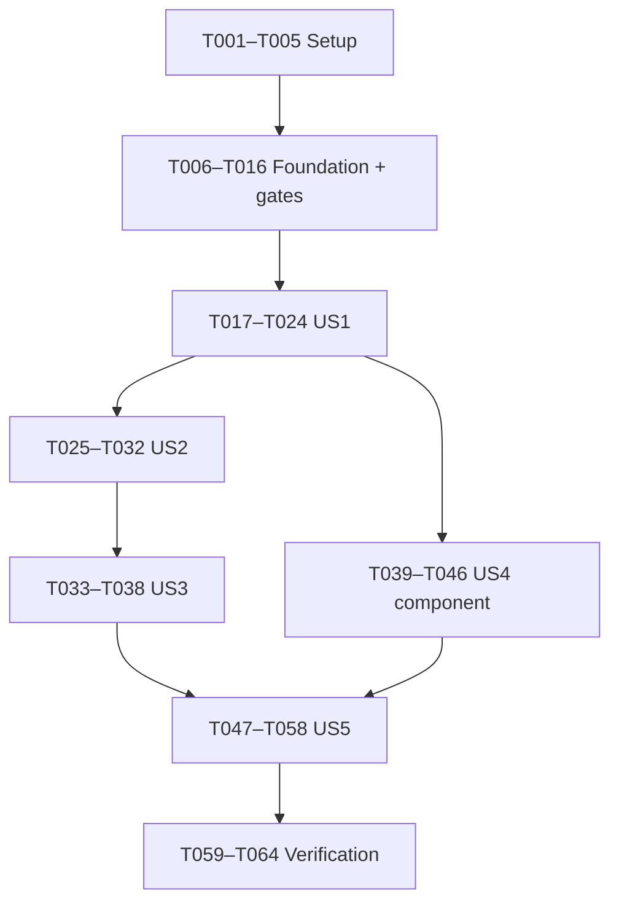

> Cập nhật ngày 2026-09-09: mọi task DB dùng MySQL 8.4 LTS, Connector/J và Flyway.
> Schema 20 bảng nằm tại V1; V2 bắt buộc ngày theo loại đợt; V3 bắt buộc khoảng GV
> hoàn thành trước khi khoảng SV bắt đầu.
> Chạy bằng `./run.sh` trên macOS/Linux hoặc `run.cmd` trên Windows.

# Tasks: Quản lý đợt, đề tài và đăng ký nhóm

**Input**: [spec.md](spec.md), [plan.md](plan.md), [research.md](research.md),
[data-model.md](data-model.md), [contracts/web.md](contracts/web.md), [quickstart.md](quickstart.md).
**Status**: Foundation T001–T016 hoàn thành ngày 2026-09-10; các user story tiếp theo vẫn tuân theo gate nghiệp vụ riêng. Xem [foundation-report.md](foundation-report.md).
**Tests**: Bắt buộc theo spec AT-01–15 và constitution VIII. Viết test trước phần thực thi;
chạy để chứng minh thất bại do hành vi chưa có, rồi làm cho đạt. Không coi lỗi biên dịch là bằng chứng đầy đủ.

## Format and paths

`- [ ] Txxx [P?] [USn?] mô tả và đường dẫn`. Đường dẫn tính từ root repository.
Chọn package kỹ thuật `vn.edu.topicregistration` để cụ thể hóa dấu `...` trong plan;
không thay đổi nghiệp vụ. Không tạo các đường dẫn mã nguồn trong phiên tasks này.
[P] chỉ cho phép song song sau khi đã đạt các dependency của phase và gate liên quan.
Các task không [P] chạy tuần tự trong phase; các nhóm [P] cùng phase có thể chạy cùng nhau.
Mỗi task kế thừa FR/REQ/AS/AT của phase và bảng truy vết cuối tài liệu.

## Gate bắt buộc trước công việc phụ thuộc

Không được tự trả lời Q, coi “bỏ qua” là xác nhận hoặc dùng fixture làm policy thật.
Task xác nhận chỉ hoàn thành khi có câu trả lời khách hàng và tài liệu đã đồng bộ.
Nếu chưa có đáp án, giữ task và mọi task phụ thuộc chưa hoàn thành; chỉ tiếp tục nhánh độc lập.
Không dùng công cụ tự động triển khai để vượt các gate này.

| Gate | Task | Điều kiện giải phóng |
|---|---|---|
| G-Identity | T006 | Đã giải phóng: seed/import, tổ hợp role, scope; chuyển GV ngoài phiên bản đầu; ADMIN ẩn mềm nội dung vi phạm, ghi audit và khóa tài khoản nguồn |
| G-Period | T017 | Đã giải phóng: ngày bắt buộc/null theo loại, độ chính xác DATE, đổi loại, gia hạn mốc đăng ký và ngày phụ đã chốt |
| G-Topic | T025 | Đã giải phóng: mỗi topic thuộc một đợt, không reuse/copy; danh mục seed/import; chỉ tác giả đổi GVHD khi DRAFT, không thay trong quá trình thực hiện |
| G-Publish | T033 | Chốt granularity công bố và chính sách thời hạn cho quyết định dean nếu có |
| G-Group | T039 | Đã giải phóng: chỉ tạo trong hạn SV; không tự rời/chuyển, leader cũ xóa rồi leader mới thêm |
| G-Registration | T047 | Q-09: reason thủ công, ưu tiên rút/accept, lưu lịch sử |
| G-Acceptance | T007 | Đã giải phóng: AS/SC hiện tại được chấp nhận; kiểm tra bảo mật, responsive và xung đột chính; phiên bản local không có SLA định lượng |

Nếu quyết định mới mở rộng phạm vi, cập nhật spec/plan/contracts/tasks trước, không
triển khai một chức năng mới bằng cách suy rộng task hiện tại. Không có task cho reports,
hội đồng, chấm điểm, kết quả, thông báo hay quản trị tài khoản đầy đủ.

## Phase 1: Setup

Mục tiêu: chuẩn bị build/tài nguyên độc lập nghiệp vụ. Chỉ thực hiện khi có yêu cầu triển khai.

- [X] T001 Khởi tạo Java 21/Spring Boot 4.1.1 với MVC, Thymeleaf, Security, Validation, JPA, MySQL Connector/J và test dependencies theo BOM tại `pom.xml`; tạo entrypoint `src/main/java/vn/edu/topicregistration/TopicRegistrationApplication.java`, cấu hình finalName topic-registration.

- [X] T002 Tạo Maven Wrapper 3.9.x và khóa patch tại `.mvn/wrapper/maven-wrapper.properties`, `mvnw`, `mvnw.cmd`; ghi phiên bản MySQL 8.4 patch và Playwright Java được kiểm chứng vào `README.md`, dùng cùng minor LTS cho test/local.

- [X] T003 [P] Thiết lập biến môi trường MySQL, bind 127.0.0.1, local profile, ddl-auto=validate, SQL init tắt và open-in-view=false tại `src/main/resources/application.yml`, `src/main/resources/application-local.yml`; ignore secrets trong `.gitignore`, không fallback DB khác.

- [X] T004 [P] Lấy CSS/JS và tài nguyên được tham chiếu từ Tabler 1.4.0 theo research R-03 vào `src/main/resources/static/vendor/tabler/1.4.0/`; giữ banners, chép LICENSE vào `licenses/tabler-1.4.0-LICENSE`, lập nguồn/version/checksum/license của từng tài nguyên tại `THIRD_PARTY_NOTICES.md`; không nạp Bootstrap hai lần hoặc phụ thuộc runtime CDN.

- [X] T005 Chuyển layout/menu/header/error components Tabler thành `src/main/resources/templates/layouts/main.html`, `src/main/resources/templates/layouts/error.html` và các fragment dùng chung trong `src/main/resources/templates/fragments/`; bổ sung `src/main/resources/static/css/app.css`, `src/main/resources/static/js/app.js` cho labels, keyboard, empty/loading/error và system font local; không đưa demo nghiệp vụ vào app.

## Phase 2: Foundational

Mục tiêu: quyết định nền tảng dữ liệu/quyền, hạ tầng bảo mật và test dùng chung.
**Chặn tất cả user stories cho tới khi T006–T016 hoàn thành.**
T006–T007 là việc xác nhận tài liệu; không tự tạo đáp án. T008–T016 phụ thuộc hai gate này.

- [X] T006 Hoàn tất xác nhận khách hàng cho G-Identity/Q-18 và ghi bằng chứng vào `specs/001-topic-registration/spec.md`; đồng bộ phạm vi quyền và schema tổ chức trong `specs/001-topic-registration/data-model.md`, `specs/001-topic-registration/contracts/web.md`, `specs/001-topic-registration/plan.md`; ADMIN chỉ ẩn mềm nội dung vi phạm, ghi audit, khóa tài khoản nguồn và không có quyền học vụ/đăng ký/cơ cấu tổ chức; chuyển GV ngoài phiên bản đầu.

- [X] T007 Xác nhận tiêu chí AS/SC và cách xử lý Q-20 trong `specs/001-topic-registration/spec.md`; lập `specs/001-topic-registration/acceptance-matrix.md` ánh xạ FR/REQ→AS/AT/SC→test và trạng thái xác nhận; giữ các hàng phụ thuộc gate story là blocked đến khi đáp án được ghi, không cho qua gate bằng phần trăm test giả.

- [X] T008 Đối chiếu phần identity/faculty/department/role trong `src/main/resources/db/migration/V1__full_system.sql`; tạo `FacultyEntity.java`, `DepartmentEntity.java`, `RoleEntity.java`, `UserRoleEntity.java`, `UserRoleId.java`, `UserAccountEntity.java` và `UserAccountRepository.java` tại `src/main/java/vn/edu/topicregistration/identity/persistence/`; unique username, password hash, role và FK scope đã xác nhận.

- [X] T009 Viết test login đúng/sai, chưa login, role tự khai, logout, session/CSRF và không có self-registration tại `src/test/java/vn/edu/topicregistration/web/AuthenticationTest.java` (FR-01; AS-1.5–1.8; AT-06,09–10; SC-007).

- [X] T010 Cài form login/session, PasswordEncoder, HttpOnly/SameSite, session fixation protection, CSRF và lookup identity tin cậy tại `src/main/java/vn/edu/topicregistration/shared/security/SecurityConfig.java`, `identity/application/AccountDetailsService.java`; tạo `src/main/resources/templates/auth/login.html`, không log secrets.

- [X] T011 Cài service policy đọc/ghi theo T006 và contracts tại `src/main/java/vn/edu/topicregistration/shared/security/AuthorizationPolicy.java`; role, scope, author và leader được đọc lại từ dữ liệu, không tin hidden field/session role cũ; thiếu bằng chứng quyền phải từ chối.

- [X] T012 [P] Tạo Clock có thể thay trong test và quy đổi Asia/Ho_Chi_Minh tại `src/main/java/vn/edu/topicregistration/shared/time/TimeConfig.java`; không tạo endpoint đổi giờ; kiểm thử chuyển đổi và biên tại `src/test/java/vn/edu/topicregistration/unit/TimeTest.java`.

- [X] T013 [P] Tạo exception/HTTP mapping 400/403/404/409/422 và redirect thành công theo contract tại `src/main/java/vn/edu/topicregistration/shared/web/WebExceptionHandler.java`, `src/main/resources/templates/error/error.html`; whitelist DTO, escape nội dung, không leak SQL/secret.

- [X] T014 Cấu hình Surefire/Failsafe, profiles integration/e2e và Playwright CLI tại `pom.xml`; tạo `src/test/java/vn/edu/topicregistration/integration/MySqlTestSupport.java` nhận TEST_DATABASE_* và chặn reset DB không phải DB test; không dùng H2 hoặc skip test khi thiếu cấu hình.

- [X] T015 Tạo fixture builder có clock/identity scope xác định và barrier cho nhiều connection tại `src/test/java/vn/edu/topicregistration/integration/FixtureSupport.java`, `src/test/java/vn/edu/topicregistration/concurrency/ConcurrentTestSupport.java`; tạo browser harness tự khởi động app test tại `src/test/java/vn/edu/topicregistration/e2e/BrowserTestSupport.java`.

- [X] T016 Chạy kiểm tra foundation và ghi kết quả AT-09–10 tại `specs/001-topic-registration/acceptance-matrix.md`; xác nhận login không cấp sai quyền, secrets không bị log, lỗi rollback không đổi dữ liệu và test database được cô lập.

## Phase 3: US1 — Tạo đợt đăng ký đúng loại (P1, MVP)

**Goal:** login tài khoản cấp sẵn, dean tạo/sửa lịch đợt theo loại.
**Independent test:** fixture danh tính; tạo cả bốn loại, thử lịch sai/biên, sửa trước và
từ giờ mở GV; tài khoản sai quyền không ghi dữ liệu. Không cần topic/group.
**Trace:** FR-01–04, FR-15; REQ-01–07,28,31–32; AS-1.1–1.13; AT-01–02,06,09–10,13.
Sau T017, nhóm test T018–T019 có thể viết song song. T020 trở đi chờ tests được viết.

- [X] T017 [US1] Giải quyết G-Period/Q-02 với khách hàng; ghi required/date precision/đổi loại/sửa tên-ngày phụ vào `specs/001-topic-registration/spec.md` và đồng bộ `data-model.md`, `contracts/web.md`, `acceptance-matrix.md` cùng thư mục trước DDL hoặc validation phụ thuộc.

- [X] T018 [P] [US1] Viết unit test 4 loại/ngày bắt buộc, đổi loại, lịch ngày liên tiếp/chồng lấn, biên đầu/cuối ngày, khóa và quy tắc chỉ gia hạn theo giá trị đang lưu tại `src/test/java/vn/edu/topicregistration/unit/PeriodRulesTest.java` (AT-01–02,13).

- [X] T019 [P] [US1] Viết MockMvc/DB test create/read/schedule, conditional dates theo T017, role/scope/CSRF/input sai không ghi, stale version tại `src/test/java/vn/edu/topicregistration/web/PeriodContractTest.java` (AS-1.*, AT-06,09).

- [X] T020 [US1] Đối chiếu period schema và CHECK lịch/loại/ngày từ `src/main/resources/db/migration/V1__full_system.sql`, bổ sung migration V2 vì V1 đã chia sẻ; tạo entity và repository có FOR UPDATE tại `src/main/java/vn/edu/topicregistration/periods/persistence/RegistrationPeriodEntity.java`, `RegistrationPeriodRepository.java` (DB-01–02).

- [X] T021 [US1] Cài transaction READ COMMITTED và khóa period trước mutation tại `src/main/java/vn/edu/topicregistration/periods/application/PeriodTransactionService.java`; sau chờ đọc lại quyền/giờ/version, không lấy child lock trước period; create period mới xác thực trước insert.

- [X] T022 [US1] Cài create/update và trạng thái thời gian suy ra tại `src/main/java/vn/edu/topicregistration/periods/application/PeriodService.java`, `periods/domain/PeriodRules.java`; chỉ gia hạn mốc kết thúc/ngày phụ theo T017, không rút ngắn, mở lại, tự công bố hoặc auto-reject do hết hạn.

- [X] T023 [US1] Cài GET/POST periods và sửa cấu hình theo contract tại `src/main/java/vn/edu/topicregistration/periods/web/PeriodController.java`, `PeriodForm.java`; tạo `src/main/resources/templates/periods/list.html`, `detail.html`, `form.html` với dữ liệu scope, trạng thái trường bị khóa và lỗi validation.

- [X] T024 [US1] Kiểm thử sửa lịch đồng thời với mở đợt, kiểm tra thời gian sau chờ khóa tại `src/test/java/vn/edu/topicregistration/concurrency/PeriodScheduleIT.java`; chạy nghiệm thu US1 và ghi AT-01–02,13/SC-001 tại `specs/001-topic-registration/acceptance-matrix.md`.

## Phase 4: US2 — Giảng viên đăng đề tài có hướng dẫn (P1)

**Goal:** tác giả soạn nháp và gửi đủ nội dung/GVHD đúng bộ môn trong hạn.
**Independent test:** fixture đợt/GV; 1–2 GVHD hợp lệ, thiếu từng trường/ngoài hạn/sai
department/tác giả bị từ chối. Không cần UI công bố.
**Trace:** FR-05–06,14; REQ-03,08–11,31–32; AS-2.1–2.11; AT-02–03,06,09,12.
US1 và T025 đã hoàn tất; T026–T027 có thể thực hiện song song.

- [X] T025 [US2] Xác nhận G-Topic/Q-05/06 trong `specs/001-topic-registration/spec.md`: topic theo đợt/reuse, nguồn danh mục, phạm vi thay GVHD; đồng bộ `data-model.md`, `contracts/web.md` và `tasks.md` trước khi schema dự kiến cần thay; không tự mở chức năng ngoài phạm vi.

- [ ] T026 [P] [US2] Viết test nội dung 5 trường, 0/1/2/3 GVHD đầu vào, same department, actor tác giả, gửi lại/biên hạn và khóa ngoài DRAFT tại `src/test/java/vn/edu/topicregistration/unit/TopicRulesTest.java` (AT-03,12).

- [ ] T027 [P] [US2] Viết contract test create/read/edit/submit với giả mạo author/department, scope, CSRF, escaping và dữ liệu không đổi tại `src/test/java/vn/edu/topicregistration/web/TopicAuthorContractTest.java` (AS-2.*, AT-06,09).

- [X] T028 [US2] Đối chiếu topics/topic_supervisors trong `src/main/resources/db/migration/V1__full_system.sql`; tạo migration V4 thêm `hidden_at`, `hidden_by`, `hidden_reason` cho topics và tạo entity/repositories `src/main/java/vn/edu/topicregistration/topics/persistence/TopicEntity.java`, `TopicSupervisorEntity.java`, `TopicRepository.java`; DB-03–04, topic/period unique composite, supervisor slot là kỹ thuật không phải vai trò chính/phụ.

- [X] T029 [US2] Cài draft/save/submit dưới khóa period tại `src/main/java/vn/edu/topicregistration/topics/application/TopicAuthorService.java`, `topics/domain/TopicRules.java`; validate tối thiểu GVHD khi gửi, không CHECK cross-table; không cho người khác sửa hoặc sửa sau DRAFT.

- [X] T030 [US2] Cài controller/DTO tác giả tại `src/main/java/vn/edu/topicregistration/topics/web/TopicAuthorController.java`, `TopicDraftForm.java`; kiểm tra quyền trước truy vấn protected list/detail và bind whitelist, trạng thái do service quyết định.

- [X] T031 [US2] Tạo form/list/detail Tabler tại `src/main/resources/templates/topics/form.html`, `list.html`, `detail.html`; hiển thị trạng thái và 5 trường, chọn GVHD dữ liệu đáng tin cậy; nút ẩn không thay kiểm tra backend.

- [ ] T032 [US2] Viết race sửa nháp/gửi duyệt với MySQL tại `src/test/java/vn/edu/topicregistration/concurrency/TopicSubmissionIT.java`; chạy tests US2, cập nhật `specs/001-topic-registration/acceptance-matrix.md` (AT-03,12, SC-003–005).

## Phase 5: US3 — Duyệt và công bố danh sách (P1)

**Goal:** dean duyệt/từ chối và công bố đúng trạng thái.
**Independent test:** fixture PENDING_APPROVAL/APPROVED/DRAFT; chuyển trạng thái và denied
bằng các role khác; không cần tạo lại đợt. AS-3.2 đăng ký topic chưa công bố được kiểm chứng
tích hợp ở US5, không yêu cầu implement registration trong US3.
**Trace:** FR-07,14; REQ-02,08,15,31; AS-3.1–3.5; AT-06,12.
Chờ US2/T033; T034–T035 song song.

- [ ] T033 [US3] Chốt G-Publish: đối chiếu AS-3.1 và xác nhận công bố từng/tập/toàn danh sách, thời hạn xử lý dean nếu có trong `specs/001-topic-registration/spec.md`; cập nhật `contracts/web.md`, `data-model.md`, `acceptance-matrix.md` trước áp route publish tập hợp đề xuất.

- [ ] T034 [P] [US3] Viết state test approve/reject/publish, không nhảy duyệt, reject về DRAFT và gửi lại đúng hạn tại `src/test/java/vn/edu/topicregistration/unit/TopicReviewRulesTest.java` (AT-12).

- [ ] T035 [P] [US3] Viết test HTTP scope dean, GV/tác giả/GVHD bị từ chối, publish input sai không đổi một phần tại `src/test/java/vn/edu/topicregistration/web/TopicReviewContractTest.java`; viết `TopicModerationContractTest.java` cho ADMIN ẩn mềm đề tài, audit, khóa tác giả và từ chối sửa/xóa cứng (AT-06,09,14; AS-1.15–1.16, AS-3.*).

- [ ] T036 [US3] Cài review/publish transaction theo T033 tại `src/main/java/vn/edu/topicregistration/topics/application/TopicReviewService.java`, `topics/web/TopicReviewController.java`; khóa period trước, kiểm tra lại trạng thái/quyền/version, không auto-publish theo đồng hồ.

- [ ] T037 [US3] Tạo giao diện duyệt/công bố tại `src/main/resources/templates/topics/review.html`; tích hợp trạng thái công bố với truy vấn danh sách tại `src/main/java/vn/edu/topicregistration/topics/application/PublishedTopicQueryService.java`, không hiển thị dữ liệu ngoài scope; cài `TopicModerationService.java` và route ADMIN `/admin/moderation/topics/{id}/hide` theo contract mà không cấp quyền học vụ.

- [ ] T038 [US3] Chạy fixture review/publication trong `src/test/java/vn/edu/topicregistration/integration/TopicPublicationIT.java`; ghi kết quả US3 và phần AS-3.2 còn chờ US5 tại `specs/001-topic-registration/acceptance-matrix.md`.

## Phase 6: US4 — Quản lý nhóm và trưởng nhóm (P1)

**Goal:** nhóm 1–3 SV, một leader; sửa đúng quyền và thời gian.
**Independent test:** fixture SV/đợt; tạo/thêm/xóa/chuyển leader, trùng SV cùng đợt và khác
đợt, denied người ngoài. Việc freeze bằng đăng ký thật được tích hợp US5.
**Trace:** FR-08–09; REQ-12–13,31; AS-4.1–4.14; AT-04,06–08.
Chờ US1/T039; có thể phát triển nhánh US4 song song nhánh US2→US3 sau các gate.

- [X] T039 [US4] Giải quyết G-Group/Q-07 trong `specs/001-topic-registration/spec.md`: thời điểm tạo nhóm và phạm vi tự rời/chuyển; đồng bộ `data-model.md`, `contracts/web.md`, `acceptance-matrix.md` và task nếu phạm vi đổi, không suy ra lịch tạo từ lịch sửa.

- [ ] T040 [P] [US4] Viết unit test 1–3 thành viên, duy nhất leader thuộc nhóm, chuyển cho thành viên, chỉ sửa trong hạn và không active tại `src/test/java/vn/edu/topicregistration/unit/GroupRulesTest.java` (AS-4.*, AT-04).

- [ ] T041 [P] [US4] Viết contract test nhóm create/read/add/remove/leader với role/scope, leader cũ/người ngoài, thêm trực tiếp không invitation và không ghi khi denied tại `src/test/java/vn/edu/topicregistration/web/GroupContractTest.java` (AT-06,09).

- [X] T042 [US4] Đối chiếu group schema DB-05–07 trong `src/main/resources/db/migration/V1__full_system.sql`, slot 1–3, UNIQUE SV/đợt và trigger tự tạo membership trưởng nhóm; tạo entity/repository tại `src/main/java/vn/edu/topicregistration/groups/persistence/StudentGroupEntity.java`, `GroupMembershipEntity.java`, `StudentGroupRepository.java`; backend không insert lặp leader membership.

- [X] T043 [US4] Cài group rules/create/add/remove/transfer dưới khóa period tại `src/main/java/vn/edu/topicregistration/groups/application/GroupService.java`, `groups/domain/GroupRules.java`; khai báo `groups/application/ActiveRegistrationQuery.java` làm port bắt buộc, không dùng stub luôn false trong runtime; adapter thật ở T054.

- [X] T044 [US4] Cài routes/form nhóm tại `src/main/java/vn/edu/topicregistration/groups/web/GroupController.java`, `GroupMemberForm.java`; tạo `src/main/resources/templates/groups/detail.html`, `form.html` và kiểm soát trường SV được phép xem theo T006.

- [ ] T045 [US4] Viết MySQL race thêm người thứ tư, cùng SV vào hai nhóm, chuyển leader đồng thời sửa tại `src/test/java/vn/edu/topicregistration/concurrency/GroupMembershipIT.java`; kiểm tra trigger giữ leader và unique key (AT-04,07–08).

- [ ] T046 [US4] Chạy test US4 bằng fixture active/inactive, ghi phần freeze cần adapter thật T054 và E2E US5 vào `specs/001-topic-registration/acceptance-matrix.md`; không tuyên bố US4 tích hợp hoàn tất trước T054/T057.

## Phase 7: US5 — Đăng ký và xử lý quyết định (P1)

**Goal:** gửi/rút/đăng ký lại; dean quyết định và auto-reject nguyên tử.
**Independent test:** seed nhóm hợp lệ/topic công bố/đợt; chạy cả accept/reject/withdraw,
nhiều pending cùng topic và các race; không phụ thuộc thao tác UI tạo fixture.
**Trace:** FR-10–13 và tích hợp FR-01,03,07–09; REQ-03,12–16,31–32;
AS-5.1–5.18, AS-3.2, AS-4.9–4.14; AT-02,04–11.
Chờ US3, các task US4 T039–T046 và T047; T048–T050 song song.

- [ ] T047 [US5] Giải quyết G-Registration/Q-09 cùng khách hàng: reason thủ công, ưu tiên rút/accept, retention trong `specs/001-topic-registration/spec.md`; đồng bộ `data-model.md`, `contracts/web.md`, `acceptance-matrix.md`; nếu ưu tiên không thể bảo đảm bằng khóa period hiện tại, sửa protocol plan trước code.

- [ ] T048 [P] [US5] Viết rules test gửi/reapply/withdraw/accept/reject, mọi biên SV, unpublished và topic đã nhận nhóm tại `src/test/java/vn/edu/topicregistration/unit/RegistrationRulesTest.java` (AT-02,05,11).

- [ ] T049 [P] [US5] Viết contract test registration create/detail/withdraw/accept/reject, scope/leader/dean/CSRF/version và reason theo T047 tại `src/test/java/vn/edu/topicregistration/web/RegistrationContractTest.java` (AT-06,09).

- [ ] T050 [P] [US5] Viết MySQL constraint test một active/nhóm, một accepted/topic/đợt, cùng đợt FK và được đăng ký lại cùng topic sau reject/rút tại `src/test/java/vn/edu/topicregistration/integration/RegistrationConstraintsIT.java` (DB-07–10; AT-05,07).

- [ ] T051 [US5] Đối chiếu registrations trong `src/main/resources/db/migration/V1__full_system.sql` theo T047 với generated-column unique DB-08–09 và trạng thái/reason DB-10; tạo entity/repository tại `src/main/java/vn/edu/topicregistration/registrations/persistence/RegistrationEntity.java`, `RegistrationRepository.java`; không UNIQUE group/topic trên toàn lịch sử.

- [ ] T052 [US5] Cài gửi/rút/đăng ký lại tại `src/main/java/vn/edu/topicregistration/registrations/application/RegistrationService.java`, `registrations/domain/RegistrationRules.java`; khóa period rồi đọc lại leader, giờ, nhóm, publication, topic accepted, active; tạo ID mới khi reapply, không rút ACCEPTED.

- [ ] T053 [US5] Cài dean accept/reject tại `src/main/java/vn/edu/topicregistration/registrations/application/RegistrationDecisionService.java`; cùng transaction accept một và reject mọi PENDING khác đúng lý do “Đề tài đã nhận nhóm”, không đổi hàng đã rút/reject; rollback toàn bộ nếu lỗi và xử lý ưu tiên theo T047.

- [ ] T054 [US5] Cài port active của US4 bằng truy vấn registrations tại `src/main/java/vn/edu/topicregistration/registrations/application/ActiveRegistrationQueryAdapter.java`; nối runtime GroupService, freeze membership/leader khi PENDING hoặc ACCEPTED và cho sửa sau reject/rút trong hạn; không phụ thuộc UI.

- [ ] T055 [US5] Cài registration controller/DTO tại `src/main/java/vn/edu/topicregistration/registrations/web/RegistrationController.java`, `RegistrationForm.java`, `RegistrationDecisionForm.java`; redirect/409/422 theo contract, không nhận actor/status từ client.

- [ ] T056 [US5] Tạo Tabler form/detail/decision tại `src/main/resources/templates/registrations/form.html`, `detail.html`, `decision.html`; nối danh sách topic còn nhận đăng ký và nhóm; hiển thị reason auto-reject, không thêm notification.

- [ ] T057 [US5] Viết/chạy race hai gửi cùng nhóm, hai accept cùng topic, accept/gửi mới, rút/accept theo T047, hai reapply, sửa nhóm/gửi, chuyển leader/gửi tại `src/test/java/vn/edu/topicregistration/concurrency/RegistrationConcurrencyIT.java`; nhiều connection/barrier, dữ liệu cuối không vi phạm và rollback lỗi giữa auto-reject (AT-07–08,11).

- [ ] T058 [US5] Viết/chạy browser E2E login→đợt→topic→duyệt/công bố→nhóm→gửi→accept cùng nhánh reject/rút/reapply tại `src/test/java/vn/edu/topicregistration/e2e/RegistrationJourneyE2ETest.java`; clock test xác định, không endpoint đổi giờ; ghi SC-002–005,008 và AS-3.2/4.* tích hợp trong `specs/001-topic-registration/acceptance-matrix.md`.

## Phase 8: Polish & cross-cutting verification

Chờ mọi story và gate. Không “polish” thay cho kiểm thử còn thiếu.

- [ ] T059 Tạo seeder local chủ động/idempotent tại `src/main/java/vn/edu/topicregistration/shared/seed/LocalDemoSeeder.java`: DEMO_SEED_ENABLED false mặc định, DEMO_SEED_PASSWORD ngoài source; fixture 2 bộ môn/3 GV/7 SV/dean, 4 loại đợt và trạng thái theo data-model; không reset lịch hoặc dữ liệu mỗi restart, không coi seed là provisioning thật.

- [ ] T060 Viết/chạy schema/seed tests trên MySQL từ DB rỗng và từ V trước có fixture; DB test riêng, kiểm tra đủ bảng/constraint/trigger và không sửa SQL phiên bản đã chạy.

- [ ] T061 [P] Kiểm tra toàn ma trận quyền bằng GET/POST trực tiếp, scope/quan hệ thay đổi và secret không xuất trong log tại `src/test/java/vn/edu/topicregistration/web/AuthorizationMatrixTest.java`; bổ sung mọi ca chưa được story tests bao phủ, gồm ADMIN không có quyền học vụ (FR-01–15; AT-06,08–10,14; SC-004,007).

- [ ] T062 Viết/chạy kiểm tra JAR từ thư mục khác và browser assets không dùng Tabler nguồn/CDN tại `src/test/java/vn/edu/topicregistration/e2e/AssetPortabilityE2ETest.java`; kiểm tra viewport 360/768/1280, không tràn ngang toàn trang, vùng cuộn bảng, keyboard/labels/empty/error/badges và notices đóng gói trong JAR; cập nhật đóng gói `pom.xml` nếu cần (AT-15, SC-009).

- [ ] T063 Thực hiện quickstart trên DB local bằng DBeaver, ghi lệnh thực tế/phiên bản/env/migration/seed/backup và kết quả tại `specs/001-topic-registration/quickstart.md`, `README.md`; không chỉnh schema ứng dụng thủ công và không ghi secrets vào tài liệu.

- [ ] T064 Đối chiếu mọi FR-01–15, NFR-01–02, AS, AT-01–15 và SC-001–009 trong `specs/001-topic-registration/acceptance-matrix.md`; chạy ./mvnw test, verify -Pintegration và verify -Pe2e, ghi pass/fail/blocked, rà constitution I–X tại `specs/001-topic-registration/validation-report.md`; chỉ đánh dấu feature hoàn thành nếu các Q/AC trong phạm vi đã chốt và tests đều đạt.

## Dependencies & execution order

- T001 → T002 → (T003 || T004) → T005. T005 chờ tài nguyên T004.
- Foundation: T006/T007 là quyết định tài liệu, không tạo đáp án mặc định. T007 hoàn thành
  việc xác nhận các tiêu chí độc lập, ghi rõ các tiêu chí phụ thuộc story còn blocked;
  từng story gate phải cập nhật và xác nhận các tiêu chí đó trước test/implementation.
  T008→T011 tuần tự; T012/T013 độc lập sau T011; T014→T016 chờ cả hai.
- Trong story, gate đầu tiên chặn test kết quả kỳ vọng và implementation phụ thuộc;
  các test [P] tiếp sau gate chỉ viết ở những file riêng. Task migration chờ test đã
  được viết; không yêu cầu test pass trước khi code tồn tại.
- US4 có dependency runtime ActiveRegistrationQueryAdapter ở US5. Trước T054 chỉ kiểm
  thử component bằng test double có trạng thái active/inactive; không cung cấp adapter
  runtime luôn false. US4 chỉ đạt nghiệm thu tích hợp sau T054/T057/T058.
- T059→T060; T061 có thể song song T062 sau T060 (file riêng, T061 không sửa pom.xml).
  T063 chờ T061/T062; T064 là gate hoàn thành cuối cùng.
- Không để task [P] tự ghi các file dùng chung như pom.xml, spec.md hoặc
  acceptance-matrix.md đồng thời với task khác; nếu cần sửa chung thì bỏ song song.

## Parallel examples per story

| Story | Nhóm có thể làm song song | Điều kiện |
|---|---|---|
| US1 | T018 PeriodRulesTest + T019 PeriodContractTest | Sau foundation và T017 |
| US2 | T026 TopicRulesTest + T027 TopicAuthorContractTest | Sau US1 và T025 |
| US3 | T034 TopicReviewRulesTest + T035 TopicReviewContractTest | Sau US2 và T033 |
| US4 | T040 GroupRulesTest + T041 GroupContractTest | Sau US1 và T039; dùng fixture port |
| US5 | T048 RegistrationRulesTest + T049 RegistrationContractTest + T050 RegistrationConstraintsIT | Sau US3, US4 component và T047 |

Đây là khả năng phân công khi triển khai sau này, không yêu cầu chạy agent hoặc thực thi
task trong phiên tạo tài liệu này. Nhánh US4 và US2→US3 có thể tiến song song sau US1
nếu phối hợp file tài liệu chung và không đổi public contract chung mà chưa đồng bộ.

## Coverage / traceability

Mỗi ID dưới đây dẫn tới mô tả đầy đủ và căn cứ U/E trong spec; không biến quyết định
kỹ thuật thành REQ PDF. Tests/công việc nền tảng không có REQ chức năng riêng dẫn về constitution.

| Requirement | Tasks chính | Tests / nguồn |
|---|---|---|
| FR-01 | T006,T008–T011,T016,T061 | REQ-28,31–32; AT-06,09–10,14 |
| FR-02 | T017–T024 | REQ-01,04; AT-01 |
| FR-03 | T018–T024,T026,T029,T048,T052 | REQ-02–05; AT-02,13 |
| FR-04 | T017–T023 | REQ-06–07; AT-01 |
| FR-05 | T025–T032 | REQ-08–09; AT-03,12 |
| FR-06 | T025–T032 | REQ-10–11 phần GVHD; AT-03 |
| FR-07 | T033–T038,T048,T052,T058 | REQ-02,08,15; AT-05,06,12 |
| FR-08 | T039–T046,T054,T057–T058 | REQ-12–13; AT-04,06–08 |
| FR-09 | T040–T046,T050,T057 | REQ-13; AT-04,07 |
| FR-10 | T047–T058 | REQ-03,14–15; AT-05–08,11 |
| FR-11 | T047–T058 | REQ-16 + U Q-10; AT-05–08,11 |
| FR-12 | T047–T058 | U nhánh từ chối, liên quan REQ-16; AT-05–06,11 |
| FR-13 | T047–T058 | REQ-03,14–16 + U rút/reapply; AT-02,05,07–08 |
| FR-14 | T026–T038 | REQ-02–03,08–11,15,31 + U lifecycle; AT-12 |
| FR-15 | T017–T024 | REQ-03–05,31 + U khóa lịch; AT-13 |
| SC-001 | T018–T024,T064 | Bốn loại và ngày theo xác nhận |
| SC-002 | T058,T064 | E2E cả nhánh đúng đã xác nhận |
| SC-003 | T018–T024,T026–T032,T040–T046,T048–T058,T064 | Không ghi vi phạm ở ca bị từ chối |
| SC-004 | T009,T019,T027,T035,T041,T049,T061,T064 | Mỗi thao tác cần bảo vệ có allowed/denied |
| SC-005 | T024,T032,T045,T057,T064 | Không vi phạm invariant ở tranh chấp |
| SC-006 | T007,T064 và các checkpoint story | Ánh xạ FR/REQ/AS/AT và xác nhận nghiệm thu |
| SC-007 | T009–T011,T016,T061,T064 | Không cấp sai danh tính/quyền |
| SC-008 | T048,T050–T053,T057–T058,T064 | Một accepted, không pending cạnh tranh, reason chính xác |
| SC-009 | T005,T058,T062,T064 | Responsive 360/768/1280, keyboard và không tràn ngang toàn trang |

T001–T005: quyết định stack/Tabler của người dùng và constitution V/IX.
T012–T015: constitution III–VIII; T059–T060: VII–IX; T062–T063: portability/DBeaver
người dùng yêu cầu; T064: constitution I–X. Đây là coverage công việc dự kiến,
không phải độ bao phủ test đã chạy hoặc bằng chứng đã đạt nghiệm thu.

## Implementation strategy

1. Hoàn tất các gate có câu trả lời và nền tảng. Những gate chưa trả lời giữ blocked.
2. **MVP đầu tiên:** US1 với nhận diện tài khoản cấp sẵn, tạo/sửa lịch đợt, Tabler và
   DB migrations, sau khi G-Identity/G-Period và AC tương ứng đã chốt. Chỉ demo local;
   MVP này chưa có luồng đăng ký hoàn chỉnh.
3. Tiếp tục US2→US3, song song nhánh US4 khi các điều kiện đáp ứng.
4. US5 nối adapter thật và hoàn thành MVP nghiệp vụ xuyên suốt US1–5.
5. Chạy verification, quickstart và kiểm tra DBeaver; không tuyên bố feature hoàn thành
   dựa trên số checkbox hoặc UI chạy được.

Lệnh speckit-tasks ban đầu chỉ tạo tài liệu. Việc thực thi nền tảng sau đó được người dùng yêu cầu riêng và ghi trong foundation-report.md.
Bước tiếp theo để kiểm tra nhất quán là `$speckit-analyze`; không bỏ qua gate bằng
cách gọi `$speckit-implement`.

## Generation summary

64 tasks: setup 5; foundation 11; US1 8; US2 8; US3 6; US4 8; US5 12; final 6.
Tất cả user stories P1 như spec. 16 task có [P], chỉ trong nhóm dependency đã mô tả.
