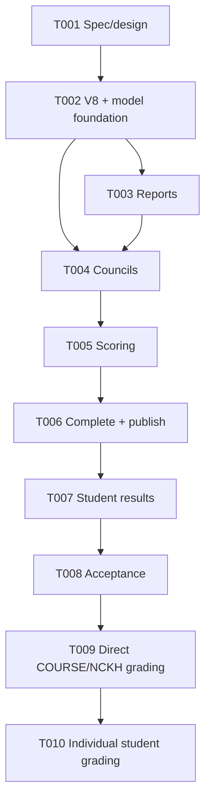

# Tasks: Báo cáo, hội đồng, chấm điểm và kết quả

**Input**: [spec.md](spec.md), [plan.md](plan.md), [research.md](research.md),
[data-model.md](data-model.md), [contracts/web.md](contracts/web.md), [quickstart.md](quickstart.md)

**Tests**: Bắt buộc theo constitution VIII. Trong mỗi task nghiệp vụ, viết test có ý nghĩa
trước implementation, xác nhận thất bại vì hành vi còn thiếu, rồi làm test đạt. Mỗi checkbox
`Txxx` là đúng một commit gồm code, test, tài liệu và evidence của task đó.

## Phase 1: Specification and design

- [X] T001 Chốt Q1:A/Q2:C/Q3:A, hoàn thiện và validate `specs/002-review-results/spec.md`, `plan.md`, `research.md`, `data-model.md`, `contracts/web.md`, `quickstart.md`, `checklists/requirements.md`, `tasks.md`; cập nhật `.specify/state/feature.json`, chạy `git diff --check` và commit riêng tài liệu feature.

**Checkpoint**: Checklist 16/16, không còn `[NEEDS CLARIFICATION]`, constitution pre/post-design PASS.

## Phase 2: Foundational schema and model

**Purpose**: Mở khóa toàn bộ năm user story; không sửa V1–V7.

- [X] T002 Tạo test migration/schema trước, sau đó thêm `src/main/resources/db/migration/V8__implement_review_and_results.sql`; tạo enums/entities/repositories cho project report, council/member/topic, score component, evaluation và final result trong `src/main/java/vn/edu/topicregistration/entity/` và `repository/`; cập nhật `ApplicationErrorCode.java`, `application.yml`, `.gitignore` và `LayeredArchitectureTest.java`; chạy compile/unit/schema checks và commit riêng nền dữ liệu. (FR-16–25; constitution V–IX)

**Checkpoint**: Hibernate mapping khớp V8; schema biểu diễn report current, council lifecycle,
evaluation DRAFT/SUBMITTED và result READY/PUBLISHED.

**T002 evidence (2026-09-14)**: `ReviewSchemaContractTest` đã được chạy đỏ trước V8 vì
thiếu migration, sau đó schema/architecture tests đạt 3/3 và toàn bộ package unit đạt 63/63
bằng Java 21. Lần chạy suite mặc định đạt 78 test và còn 7 lỗi môi trường từ
`PeriodContractTest` cũ vì `TEST_DATABASE_URL` chưa được cấu hình; không dùng database local
có dữ liệu để thay thế. Migration MySQL tích hợp vẫn thuộc T008 khi có `TEST_DATABASE_*`.

## Phase 3: User Story 1 — Nộp/xem báo cáo (P1, MVP)

**Goal**: Snapshot leader upload/replace PDF; đúng người xem download; khóa từ ACTIVE.

**Independent Test**: Fixture registration ACCEPTED, PDF hợp lệ/sai, các actor leader/member/
supervisor/dean/council member/outsider và council trước/sau ACTIVE.

- [X] T003 [US1] Viết `ReportRulesTest.java`, `ReportServiceTest.java`, `ReportControllerTest.java` trước; cài safe local storage, `ReportUploadForm`, `ReportService`, `ReportController` và templates trong `src/main/java/vn/edu/topicregistration/{config,dto,repository,service,controller}/` cùng `src/main/resources/templates/reports/`; nối link từ registration detail, kiểm tra PDF <=20 MB/quyền/replace/rollback, chạy tests và commit riêng report. (FR-16–17,24–25; AS-6.1–6.5; SC-010)

**Checkpoint**: bytes tải lại đúng, outsider không thấy metadata, upload bị khóa khi council ACTIVE.

**T003 evidence (2026-09-14)**: ba test report được viết trước và chạy đỏ vì API chưa có,
sau đó chạy đỏ hành vi 10 ca với khung chưa triển khai. Implementation đạt 15/15 ca report/
error mục tiêu và regression không cần MySQL đạt 90/90; kiểm tra gồm PDF signature/20 MB,
generated storage key, path traversal, quyền, replace theo version, cleanup khi DB lỗi,
download headers và multipart vượt giới hạn trả 422.

## Phase 4: User Story 2 — Hội đồng 3–5 người (P1)

**Goal**: DEAN lập board TLCN/KLTN nhiều nhóm cùng faculty và kích hoạt đúng state.

**Independent Test**: Fixture accepted registrations và lecturers; thử 3/5 hợp lệ, 2/6,
trùng chức danh/member, khác faculty, supervisor, COURSE/NCKH và duplicate assignment.

- [X] T004 [US2] Viết `CouncilRulesTest.java`, `CouncilServiceTest.java`, `CouncilControllerTest.java` trước; cài `CouncilForm`, `CouncilAssignmentForm`, `CouncilService`, `CouncilController` và templates `src/main/resources/templates/councils/`; hỗ trợ DRAFT→ASSIGNED→SCHEDULED→ACTIVE, period-first locking, nhiều registration cùng faculty, backend scope và stale version; chạy tests và commit riêng council. (FR-18–19,24; AS-7.1–7.6; SC-011)

**Checkpoint**: Không council ACTIVE nào vi phạm 3–5/member role/faculty/supervisor/report.

**T004 evidence (2026-09-14)**: Ba lớp test council được viết và chạy đỏ trước vì API chưa
có; ca revalidate lecturer sau đó cũng được chạy đỏ trước khi siết service. Rules/service/web
đạt 18/18, gồm 3–5 member, role/khoa, supervisor, scope, stale version, field whitelist,
lock period→council→children và report hiện hành khi activate. Regression không cần MySQL/E2E
đạt 108/108. Suite mặc định chạy 115 test: 108 đạt, 7 lỗi môi trường cũ ở
`PeriodContractTest` vì thiếu `TEST_DATABASE_URL`; không dùng database local có dữ liệu thật.

## Phase 5: User Story 3 — Thành viên hội đồng chấm điểm (P1)

**Goal**: Mỗi assigned member lưu/submit một score 0–10 theo bước 0.25 khi board ACTIVE.

**Independent Test**: Fixture ACTIVE board; member, outsider, supervisor và evaluator khác;
biên 0/10, mức hợp lệ 5.5/5.75, mức sai 5.6/8.55/10.01, DRAFT/SUBMITTED/resubmit và state lock.

- [X] T005 [US3] Viết `ScoreRulesTest.java`, `ScoringServiceTest.java`, `ScoringControllerTest.java` trước; cài `ScoreForm`, `ScoringService`, `ScoringController` và templates `src/main/resources/templates/scoring/`; tự bảo đảm component `Điểm hội đồng`, kiểm tra assignment/supervisor/status/version và cho sửa SUBMITTED khi còn ACTIVE; chạy tests và commit riêng scoring. (FR-20,24–25; AS-8.1–8.5; SC-012)

**Checkpoint**: Một evaluation/evaluator/registration; không actor trái phép hoặc score sai được lưu.

**T005 evidence (2026-09-14)**: Rules/service/web tests được viết và chạy đỏ trước khi có
API scoring. Sau implementation, 15/15 ca mục tiêu đạt: biên 0/10, scale tối đa 2, DRAFT/
SUBMITTED/resubmit, stale version, tự tạo component hệ thống, outsider/supervisor/state lock,
field whitelist và thứ tự khóa period→council→children/evaluations. Regression không cần
MySQL/E2E đạt 123/123; schema và layered architecture checks đều đạt.

## Phase 6: User Story 4 — Tổng hợp và publish kết quả (P1)

**Goal**: Chair complete/mean và DEAN publish toàn hội đồng nguyên tử.

**Independent Test**: Board ACTIVE đủ/thiếu score, Chair/non-Chair, DEAN khác faculty,
READY/PUBLISHED và thao tác concurrent complete/publish.

- [X] T006 [US4] Viết `FinalScoreRulesTest.java`, `ResultServiceTest.java` và phần faculty của `ResultControllerTest.java` trước; cài DTO/view, `ResultService`, `ResultController` cùng templates faculty trong `src/main/resources/templates/results/`; Chair complete toàn board với mean HALF_UP scale 2, DEAN publish toàn board và xem result đúng scope, khóa score/report sau complete; chạy tests và commit riêng tổng hợp/công bố. (FR-21–22,24; AS-9.1–9.5; SC-013,015)

**Checkpoint**: Không publish thiếu evaluation; student chỉ thấy result PUBLISHED của snapshot mình.

**T006 evidence (2026-09-14)**: Rules/service/faculty web tests được chạy đỏ trước phần
implementation còn thiếu, sau đó đạt 18/18. Complete khóa period→council→assignments/
members/evaluations/results, chỉ cho Chair hiện tại tạo toàn bộ result READY từ ma trận
SUBMITTED đầy đủ với arithmetic mean `HALF_UP` scale 2; publish chỉ cho DEAN đúng faculty
đổi toàn bộ READY result và council sang PUBLISHED trong một transaction, có version/actor/
time và không publish một phần. Chair không kiêm DEAN vẫn mở được board từ màn hình chấm để
tổng hợp; danh sách/chi tiết quản trị vẫn giới hạn faculty. Regression không cần MySQL/E2E
đạt 141/141. Suite mặc định chạy 148 test: 141 đạt, 7 lỗi môi trường cũ ở
`PeriodContractTest` vì thiếu `TEST_DATABASE_URL`; integration/concurrency thật thuộc T008.

## Phase 7: User Story 5 — Sinh viên xem kết quả (P1)

**Goal**: Snapshot student chỉ xem result PUBLISHED của đăng ký mình tham gia.

**Independent Test**: Hai registration snapshot khác nhau, READY/PUBLISHED, current membership
đã đổi và direct URL để kiểm tra không lộ metadata/score/feedback.

- [X] T007 [US5] Viết phần student privacy của `ResultControllerTest.java` và `StudentResultServiceTest.java` trước; mở rộng `ResultService`, `ResultController` và templates student trong `src/main/resources/templates/results/` cho list/detail PUBLISHED dựa trên `registration_members`, từ chối outsider/current-member-only/ADMIN và dữ liệu chưa publish; chạy tests và commit riêng student results. (FR-23–24; AS-10.1–10.4; SC-014)

**Checkpoint**: Student chỉ thấy result PUBLISHED của snapshot mình; DEAN/ADMIN giữ scope đã chốt.

**T007 evidence (2026-09-14)**: Student service/privacy và hai route HTML đạt 6/6 ca mục
tiêu. Cả list lẫn detail lọc tại repository bằng `registration_members` snapshot và trạng
thái PUBLISHED; direct ID của nhóm khác hoặc READY trả lỗi chung trước khi đọc evaluation,
membership hiện tại không cấp quyền và ADMIN không gọi được truy vấn sinh viên. Regression
không cần MySQL/E2E đạt 147/147. Suite mặc định chạy 154 test: 147 đạt, 7 lỗi môi trường
cũ ở `PeriodContractTest` vì thiếu `TEST_DATABASE_URL`; truy vấn JPA trên MySQL và E2E thuộc
T008.

## Phase 8: Cross-cutting acceptance

- [X] T008 Nối menu theo role tại `NavigationModelAdvice.java` và `templates/fragments/sidebar.html`, bổ sung fixture demo an toàn trong `LocalDemoSeeder.java`, test V8/integration/concurrency/E2E tại `src/test/java/vn/edu/topicregistration/{integration,concurrency,e2e}/`, cập nhật `README.md`, `specs/002-review-results/quickstart.md` và tạo `acceptance-matrix.md`; chạy `env -u JAVA_HOME ./mvnw test`, `verify -Pintegration`, `verify -Pe2e`, `git diff --check`, ghi PASS/FAIL/BLOCKED trung thực và commit riêng acceptance. (FR-16–25; SC-010–016)

**T008 evidence (2026-09-15)**: Menu theo role, luồng lập hội đồng, fixture review có file
thật và ma trận nghiệm thu đã hoàn tất. Trên MySQL 8.4.11 test cô lập, suite mặc định đạt
157/157, integration/concurrency đạt 18/18 và E2E đạt 2/2. Browser journey xác nhận upload,
submit điểm có CSRF, complete, publish và privacy 404; `git diff --check` đạt.

## Phase 9: Direct grading for COURSE/NCKH

- [X] T009 [US2A] TDD quy tắc và service phân công đúng một grader khác mọi GVHD cho đăng ký
  COURSE/NCKH ACCEPTED đã có report; thêm V10 `grading_mode`/trigger one-member, trang riêng
  cho Trưởng khoa, reuse scoring/complete/publish và khóa report ngay khi phân công; giữ
  nguyên hội đồng TLCN/KLTN 3–5 người; cập nhật spec/plan/data-model/contracts/acceptance,
  chạy targeted/regression/migration checks và `git diff --check`. (FR-26; AS-7.7–7.10;
  SC-017)

**Checkpoint**: COURSE/NCKH có đúng một grader ACTIVE khác GVHD; TLCN/KLTN chỉ đi qua
`COUNCIL`; một điểm SUBMITTED có thể complete/publish và report không còn được thay.

**T009 evidence (2026-09-17)**: Rules/service/web tests được chạy đỏ trước vì API chấm độc
lập chưa tồn tại. Sau implementation, targeted rules/service/controller/schema/result và
regression council/scoring đạt 53/53. Trên MySQL 8.4.11 test cô lập, migration V10 từ database
rỗng, V6 và V7 đạt 4/4; toàn integration/concurrency đạt 17/18, còn một assertion baseline
`ReviewWorkflowIT` kỳ vọng 13 tài khoản trong khi fixture hiện seed 14. Suite mặc định với
MySQL đạt 192/193; lỗi duy nhất là dashboard ADMIN cũ kỳ vọng 0 metrics nhưng nhận 4. Hai lỗi
ngoài phạm vi không chạm mã T009; `git diff --check` đạt.

**T009 migration follow-up (2026-09-17)**: Database local đã có V9
`enforce organization catalog uniqueness`, nên migration chấm độc lập được chuyển sang V10
và V9 cũ được khôi phục nguyên checksum. `./workspace/scripts/run.sh` validate 10 migration, nâng schema hiện
hữu từ V9 lên V10 và khởi động thành công mà không `repair`/xóa dữ liệu; migration test từ
database rỗng, V6 và V7 tiếp tục đạt 4/4.

## Phase 10: Individual grading per registration student

- [X] T010 [US3–US5] TDD chấm điểm riêng cho từng sinh viên snapshot: thêm V11 và composite
  FK/unique cho evaluation/final result, backfill điểm nhóm cũ cho từng thành viên; đổi UI
  chấm sang danh sách sinh viên + phiếu từng người; chỉ complete khi đủ ma trận
  registration × student × evaluator; tạo/publish/result detail riêng từng sinh viên và
  chặn sinh viên xem điểm cùng nhóm của nhau; cập nhật spec/plan/data-model/contracts/
  quickstart/acceptance, chạy targeted/regression/migration checks và `git diff --check`.
  (FR-27; AS-8.6,9.6,10.5; SC-018)

**T010 evidence (2026-09-22, acceptance PASS)**: Test đỏ ban đầu xác nhận thiếu V11 và
rules chưa hỗ trợ ma trận sinh viên. Sau implementation cùng các follow-up, targeted
unit/web đạt 47/47; suite mặc định đạt 200/200. Trên MySQL 8.4 test cô lập, Flyway áp dụng
đủ 11 migration, integration/concurrency đạt 18/18 và E2E Playwright đạt 2/2. Hành trình
browser xác nhận hai sinh viên cùng registration nhận điểm riêng, không thấy nhận xét của
nhau; sinh viên ngoài snapshot nhận 404. Migration V10→V11, backfill, Hibernate schema
validation, `./workspace/scripts/run.sh` và `git diff --check` đều đạt; không dùng database phát triển để chạy
test phá dữ liệu.

**T010 scoring follow-up (2026-09-21)**: Theo xác nhận bổ sung của người dùng, test đỏ chứng
minh backend còn nhận `5.6`/`8.55` và UI render `8.00`/`8.50`. Rule đã đổi sang bước 0.25,
form HTML dùng `step=0.25`, điểm input/list/result dùng định dạng gọn không có số 0 dư;
targeted rules/format/controller đạt 18/18 và toàn targeted T010 đạt 47/47. Gate
integration/E2E sau đó đạt trên database test cô lập như bằng chứng acceptance ở trên.

**T010 result-period follow-up (2026-09-21)**: Danh sách kết quả Trưởng khoa đã mang thêm
`periodId/periodName`, hiển thị cột Đợt đăng ký và lọc GET theo đợt trong tập kết quả đã được
service giới hạn theo khoa. Follow-up kiểm tra trước công bố bổ sung lọc `registrationId` và
nút xem điểm từng sinh viên ngay ở lượt COMPLETED, nên không trộn nhóm khác. Targeted tests
liên quan đạt 26/26 sau khi bổ sung lọc kết hợp giảng viên/trạng thái và loại bỏ các nút
điều hướng chéo ở header; suite đầy đủ sau đó đạt 200/200 cùng các gate integration/E2E.

## Dependencies & execution order

- T003 phải có trước activate ở T004 vì activate revalidate report hiện hành.
- T005 phụ thuộc ACTIVE council; T006 phụ thuộc SUBMITTED evaluations.
- Các task không đánh dấu `[P]` vì cùng sửa migration/model hoặc integration surfaces và phải
  được commit tuần tự theo chính sách repository.
- T008 không được đổi business policy; lỗi phát hiện sau commit dùng fix commit tham chiếu task gốc.

## Traceability

| Story / requirement | Tasks | Automated evidence |
|---|---|---|
| US1 / FR-16–17 | T002–T003,T008 | rules/service/web/storage/integration |
| US2 / FR-18–19 | T002,T004,T008 | rules/service/web/schema/concurrency |
| US3 / FR-20 | T002,T005,T008 | rules/service/web/concurrency |
| US4 / FR-21–22 | T002,T006,T008 | calculator/service/web/concurrency |
| US5 / FR-23 | T007–T008 | service/web/E2E privacy |
| FR-24–25 | T002–T008 | authorization/error/storage matrix |
| US2A / FR-26 | T009 | rules/service/web/schema/final-score regression |
| US3–US5 / FR-27 | T010 | scoring/result/web/schema/privacy regression |

## Implementation strategy

T001–T002 là gate bắt buộc. Sau đó hoàn thiện từng vertical journey nhưng đặt class vào các
package MVC ngang đã chốt. MVP đầu tiên là T003 report; luồng đầy đủ cần T004–T007. T008 chỉ
đánh dấu feature sẵn sàng khi các test bắt buộc có môi trường đều pass; thiếu MySQL test hoặc
Playwright phải ghi BLOCKED, không dùng database có dữ liệu thật và không bỏ qua test.

## Generation summary

10 tasks: design 1; foundation 1; reports 1; councils 1; direct grading 1; individual grading 1; scoring 1;
result publication 1; student privacy 1; cross-cutting acceptance 1. Tất cả checklist task có ID, story label khi
áp dụng và đường dẫn.
