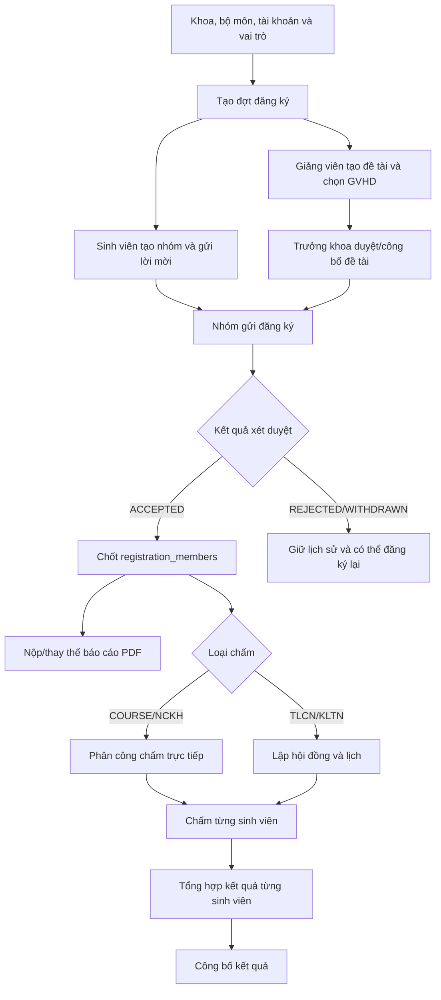
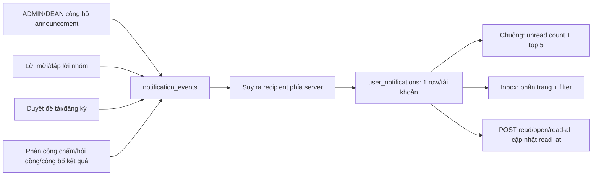

# Luồng dữ liệu — baseline gồm 27 bảng nghiệp vụ

Tài liệu này đối chiếu [V1__baseline.sql](../../database/V1__baseline.sql), nguồn sự thật duy nhất của cấu trúc.
Sơ đồ quan hệ
được duy trì riêng tại [class-diagram.mmd](class-diagram.mmd).

## Danh mục và mục đích dữ liệu

| Nhóm | Bảng | Vai trò |
|---|---|---|
| Tổ chức và tài khoản | `faculties`, `departments`, `roles`, `user_accounts`, `user_roles`, `student_profiles` | Khoa, Bộ môn, danh tính, hồ sơ sinh viên, trạng thái tài khoản và role được backend kiểm tra. |
| Đợt và đề tài | `registration_periods`, `topics`, `topic_supervisors` | Mốc đăng ký, nội dung/trạng thái đề tài, tác giả và giảng viên hướng dẫn. |
| Nhóm sinh viên | `student_groups`, `group_memberships`, `group_invitations` | Nhóm hiện tại, thành viên hiện tại và lịch sử lời mời/phản hồi. |
| Đăng ký | `registrations`, `registration_members` | Một lần nhóm đăng ký và snapshot bất biến từng sinh viên tại thời điểm nộp. |
| Báo cáo và chấm | `reviewer_assignments`, `reviewer_reports`, `reviewer_evaluations`, `project_reports`, `councils`, `council_members`, `council_topics`, `score_components`, `evaluations`, `final_results` | Phân công, file báo cáo, phản biện, chấm trực tiếp/hội đồng, điểm và kết quả riêng từng sinh viên. |
| Thông báo | `announcements`, `notification_events`, `user_notifications` | Bản nháp/công bố chính thức, sự kiện bất biến và bản nhận/read-state riêng từng tài khoản. |

## Luồng nghiệp vụ chính

LECTURER/DEAN thuộc một Faculty và được gán Department trong Faculty đó. Topic mới lấy
Department từ tác giả; GVHD phối hợp phải cùng Department. DEAN tiếp tục duyệt toàn Faculty.
Student, đợt đăng ký và Council vẫn theo Faculty; Council không có `department_id`.

`registration_members` là snapshot, không phải bản sao động của `group_memberships`. Vì vậy thay
đổi hoặc giải thể nhóm sau khi nộp không làm đổi danh sách sinh viên nhận thông báo hay kết quả.

## Luồng thông báo V12

### 1. Nguồn chính thức

- `announcements.published_at IS NULL` là bản nháp; chỉ ADMIN cấp trường hoặc DEAN đúng khoa
  được quản lý qua backend.
- Khi công bố, transaction cập nhật announcement, tạo đúng một `notification_events` có khóa
  `ANNOUNCEMENT:{id}:PUBLISHED` và snapshot các tài khoản enabled trong scope.
- Tài khoản tạo sau không nhận ngược; announcement đã công bố không sửa/xóa trong phiên bản này.

### 2. Sự kiện nghiệp vụ tự động

Các service nhóm, đề tài, đăng ký, phân công chấm, hội đồng và kết quả gọi emitter sau khi mọi
validation thành công nhưng trước khi transaction commit. `notification_events` giữ title/body,
loại sự kiện, actor và target nội bộ bất biến. Rollback nguồn cũng rollback event và deliveries.

### 3. Fan-out và trạng thái đọc

- `user_notifications` có unique `(event_id, recipient_id)`, nên cùng một sự kiện chỉ đến một
  tài khoản một lần.
- `read_at IS NULL` nghĩa là chưa đọc. Mark-one/open là idempotent và giữ timestamp đọc đầu tiên.
- Mark-all dùng cutoff do server tạo; delivery đến sau cutoff vẫn chưa đọc.
- Mọi count/list/update đều có `recipient_id` của principal trong query; ID của tài khoản khác
  trả 404 và không đổi dữ liệu.

### 4. Điều hướng an toàn

Event chỉ lưu `target_type` đóng và `target_id`, không lưu URL do client gửi. Server resolve route
nội bộ, sau đó controller đích vẫn kiểm tra quyền trên tài nguyên. Notification không cấp thêm quyền.

## Ràng buộc quan trọng

- `event_key` unique chống retry/tranh chấp tạo hai event cho cùng transition.
- `(event_id, recipient_id)` unique chống fan-out trùng.
- Index `(recipient_id, read_at, delivered_at, id)` phục vụ unread count/filter/read-all.
- Index `(recipient_id, delivered_at, id)` phục vụ top 5 và inbox newest-first.
- Kết quả và evaluation dùng khóa `(registration_id, student_id)`, vì điểm được chấm riêng từng
  sinh viên dù cùng nhóm.
- Báo cáo hiện hành được bảo vệ bằng generated guard; row cũ được giữ làm lịch sử.
- Chấm trực tiếp tái sử dụng cấu trúc council với `grading_mode = DIRECT`; TLCN/KLTN dùng
  `grading_mode = COUNCIL` theo workflow đã triển khai.

## Transaction và trách nhiệm backend

Ràng buộc DB bảo vệ FK, unique, checks và một số invariants bằng trigger. Backend vẫn phải kiểm tra
role/scope, mốc thời gian, quyền nhóm, xung đột GVHD–người chấm, trạng thái transition, CSRF và
quyền tài nguyên đích. Không dựa vào việc ẩn nút ở giao diện.

Baseline tạo trực tiếp schema cuối cùng, không còn các bước backfill lịch sử. Database cũ từng
chạy V1–V26 phải được tạo lại. Sau khi baseline được chia sẻ, thay đổi schema tiếp theo phải dùng
migration version mới thay vì sửa V1.
