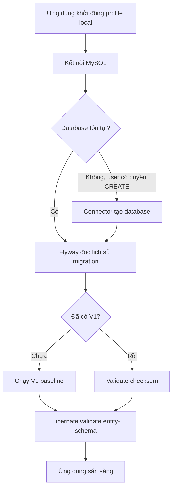
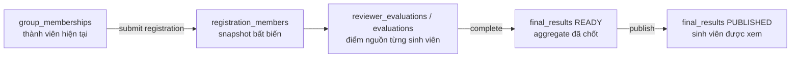
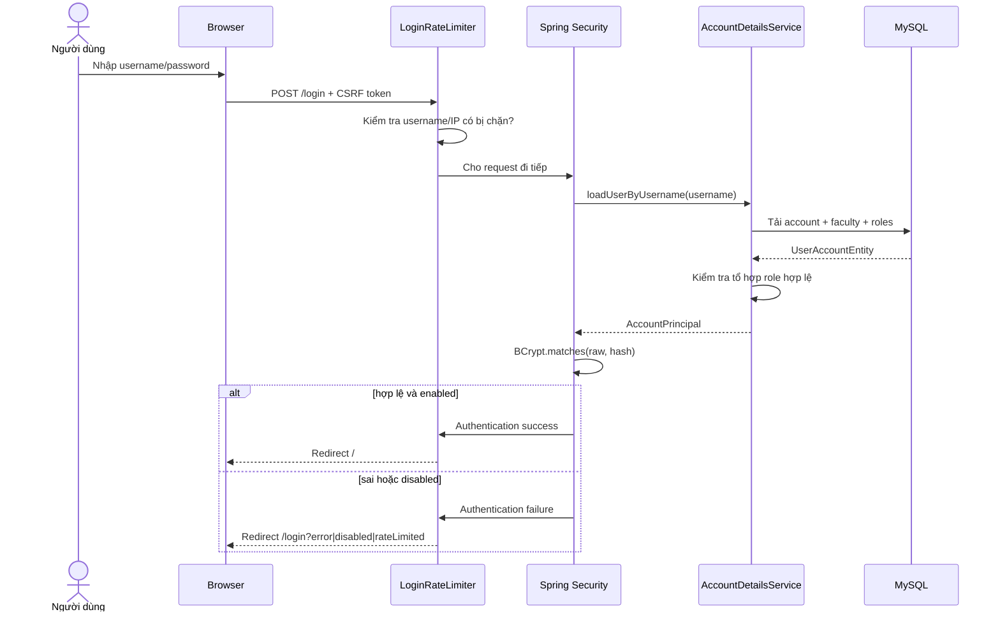
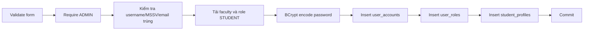
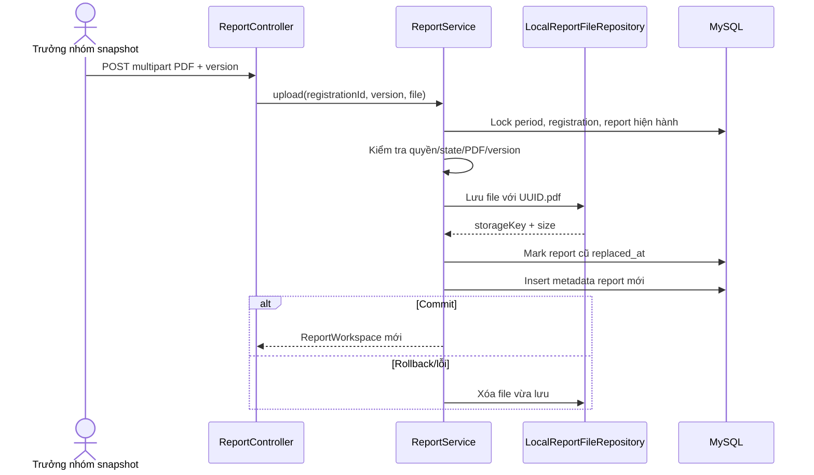
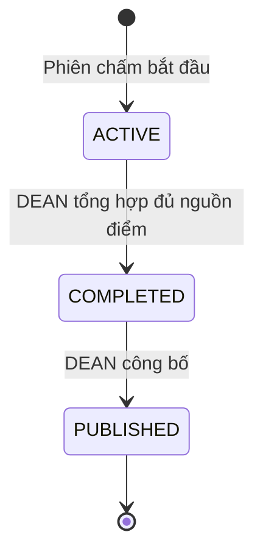

# Cẩm nang học và báo cáo: Cơ sở dữ liệu, xác thực, phân quyền, tài khoản và kết quả

> Phạm vi tài liệu: phần việc **thiết kế cơ sở dữ liệu; xây dựng đăng nhập, phân quyền,
> quản lý tài khoản; xử lý báo cáo và tổng hợp kết quả** trong hệ thống quản lý đăng ký đề tài.
>
> Tài liệu này mô tả **implementation đang có trên nhánh hiện tại**. Khi tài liệu lịch sử hoặc
> SpecKit khác với code, code và schema hiện tại được dùng làm căn cứ báo cáo.

## 1. Mục tiêu học tập

Sau khi đọc tài liệu, người báo cáo cần giải thích được:

1. Vì sao hệ thống dùng MySQL, Flyway và Hibernate ở chế độ `validate`.
2. Cách 27 bảng nghiệp vụ liên kết và bảo vệ tính toàn vẹn dữ liệu.
3. Một yêu cầu đăng nhập đi qua những thành phần nào trước khi tạo session.
4. Sự khác nhau giữa xác thực, phân quyền theo role và phân quyền theo tài nguyên.
5. ADMIN tạo, lọc, khóa, mở khóa và đặt lại mật khẩu tài khoản như thế nào.
6. Cách hệ thống lưu file báo cáo PDF an toàn mà không nhét nội dung file vào MySQL.
7. Cách hệ thống tổng hợp điểm thành `final_results`, công bố và giới hạn sinh viên chỉ xem
   kết quả của chính mình.
8. Các quyết định kỹ thuật, giới hạn hiện tại và cách kiểm thử từng phần.

## 2. Bản đồ kiến trúc và nguồn cần đọc

Luồng chuẩn của dự án:

```text
Browser
  ↓ HTTP request
Controller        nhận request, bind form, validation HTTP, chọn view/redirect
  ↓
Service/Rules     nghiệp vụ, transaction, authorization, state transition
  ↓
Repository        JPA query hoặc lưu dữ liệu
  ↓
MySQL             PK, FK, unique, check, generated column và trigger
```

Các nguồn quan trọng:

| Phạm vi | Nguồn chính |
|---|---|
| Schema | [`database/V1__baseline.sql`](../../database/V1__baseline.sql) |
| Mô tả database | [`database/README.md`](../../database/README.md) |
| Luồng dữ liệu | [`database/DATA_FLOW.md`](../../database/DATA_FLOW.md) |
| Sơ đồ quan hệ | [`database/class-diagram.mmd`](../../database/class-diagram.mmd) |
| Cấu hình database/Flyway | [`application-local.yml`](../../src/main/resources/application-local.yml) |
| Cấu hình JPA, upload và session | [`application.yml`](../../src/main/resources/application.yml) |
| Đăng nhập | [`SecurityConfig.java`](../../src/main/java/vn/edu/topicregistration/security/SecurityConfig.java) |
| Tải danh tính | [`AccountDetailsService.java`](../../src/main/java/vn/edu/topicregistration/security/AccountDetailsService.java) |
| Phân quyền | [`AuthorizationPolicy.java`](../../src/main/java/vn/edu/topicregistration/security/AuthorizationPolicy.java) |
| Quản lý tài khoản | [`AdminAccountService.java`](../../src/main/java/vn/edu/topicregistration/service/AdminAccountService.java) |
| Đổi mật khẩu | [`AccountSecurityService.java`](../../src/main/java/vn/edu/topicregistration/service/AccountSecurityService.java) |
| Báo cáo PDF | [`ReportService.java`](../../src/main/java/vn/edu/topicregistration/service/ReportService.java) |
| Tổng hợp kết quả | [`ResultService.java`](../../src/main/java/vn/edu/topicregistration/service/ResultService.java) |
| Quy tắc tính điểm | [`FinalScoreRules.java`](../../src/main/java/vn/edu/topicregistration/service/FinalScoreRules.java) |

### 2.1. Nguyên tắc phân lớp

- Controller không tự truy vấn database và không tự quyết định quyền nghiệp vụ.
- Service gọi `AuthorizationPolicy`, kiểm tra trạng thái, điều phối repository và mở transaction.
- Repository chỉ làm persistence/query.
- Entity mô tả state và một số transition cục bộ như `disable()`, `resetPassword()` hoặc
  `publish()`.
- Database là lớp bảo vệ cuối cho quan hệ, uniqueness và invariant có thể biểu diễn bằng SQL.
- Không dựa vào việc ẩn nút trên giao diện để bảo mật. Người dùng vẫn có thể tự tạo HTTP request.

---

## 3. Thiết kế cơ sở dữ liệu

### 3.1. Công nghệ và chiến lược migration

- Database: **MySQL 8.4 LTS**.
- Storage engine: **InnoDB** để có transaction, foreign key và row-level locking.
- Character set: `utf8mb4`, phù hợp dữ liệu tiếng Việt.
- Schema source of truth: [`V1__baseline.sql`](../../database/V1__baseline.sql).
- Flyway đọc migration từ `filesystem:database`.
- `spring.flyway.clean-disabled=true` ngăn ứng dụng vô tình chạy Flyway clean.
- `spring.jpa.hibernate.ddl-auto=validate`: Hibernate chỉ đối chiếu entity với schema, không tự
  tạo hoặc sửa bảng.
- `spring.sql.init.mode=never`: không chạy thêm `schema.sql` hoặc `data.sql` ngoài Flyway.
- JDBC/Hibernate dùng UTC cho timestamp; giao diện đổi sang múi giờ nghiệp vụ khi hiển thị.

Luồng khởi tạo local:



Không nên sửa migration đã được chia sẻ và đã chạy trên database chung. Nếu cần thay đổi schema
trong tương lai, tạo migration phiên bản mới. Baseline hiện tại là clean-slate dành cho môi trường
local có thể tạo lại.

### 3.2. Nhóm 27 bảng nghiệp vụ

#### 3.2.1. Vì sao không gom toàn bộ dữ liệu vào một bảng?

Mục tiêu của việc chia bảng không phải là tạo ra càng nhiều bảng càng tốt. Một bảng nên đại diện
cho một khái niệm có **ý nghĩa, vòng đời, quan hệ và ràng buộc riêng**. Khi hai loại dữ liệu thay đổi
vì những lý do khác nhau, có số lượng bản ghi khác nhau hoặc cần quyền truy cập khác nhau, chúng
thường không nên bị ép vào cùng một bảng.

Giả sử toàn bộ hệ thống được lưu trong một bảng như sau:

```text
topic_registration_everything
├── user_id, username, password_hash
├── role_1, role_2
├── faculty_name, department_name
├── student_code, class_name, cohort_code
├── period_name, lecturer_start, student_start
├── topic_title, topic_author, supervisor_1, supervisor_2
├── group_id, member_1, member_2, member_3
├── registration_status
├── report_file_name, report_version_1, report_version_2
├── reviewer_name, reviewer_score
├── council_member_1_score, council_member_2_score
├── final_score
└── notification_title, notification_recipient, read_at
```

Thiết kế này nhìn ban đầu có vẻ đơn giản vì chỉ cần một bảng, nhưng nhanh chóng tạo ra các vấn đề:

1. **Lặp dữ liệu**: tên khoa, tên đợt, tên đề tài và thông tin account bị lặp trên nhiều hàng.
2. **Update anomaly**: đổi tên khoa phải cập nhật tất cả hàng liên quan; bỏ sót một hàng làm dữ
   liệu mâu thuẫn.
3. **Insert anomaly**: không thể tạo một department mới nếu chưa có account/topic để tạo cùng.
4. **Delete anomaly**: xóa registration cuối cùng có thể vô tình làm mất thông tin topic hoặc khoa.
5. **Nhiều cột null**: ADMIN không có MSSV; STUDENT không có thông tin hội đồng; phần lớn hàng chứa
   các cột không áp dụng.
6. **Số lượng bị cố định**: các cột `member_1`, `member_2` giới hạn số thành viên; muốn tăng phải sửa
   schema và code.
7. **Khó đặt constraint**: khó ngăn một student xuất hiện ở hai nhóm hoặc một user nhận cùng
   notification hai lần.
8. **Không giữ được lịch sử**: ghi đè membership/report làm mất trạng thái tại thời điểm cũ.
9. **Khó phân quyền**: scope khoa, ownership và assignment nằm lẫn trong một hàng lớn.
10. **Khó concurrency**: nhiều nghiệp vụ cùng cập nhật một hàng làm lock contention và lost update
    dễ xảy ra hơn.

Các nguyên tắc được dùng trong schema hiện tại:

| Nguyên tắc | Cách áp dụng | Lợi ích |
|---|---|---|
| Một khái niệm chính/một bảng | Account, role, topic, group, registration, council là thực thể riêng. | Tên và trách nhiệm rõ ràng. |
| Tách catalog khỏi assignment | `roles` khác `user_roles`; `councils` khác `council_members`. | Dùng lại catalog và biểu diễn nhiều-nhiều. |
| Tách dữ liệu dùng chung khỏi dữ liệu chuyên biệt | `user_accounts` khác `student_profiles`. | Tránh cột null và rule không áp dụng. |
| Tách trạng thái hiện tại khỏi bằng chứng lịch sử | `group_memberships` khác `registration_members`. | Thay đổi hiện tại không sửa quá khứ. |
| Tách phân công khỏi kết quả thực hiện | `reviewer_assignments` khác `reviewer_evaluations`. | Phân biệt “được giao” và “đã chấm”. |
| Tách dữ liệu nguồn khỏi dữ liệu tổng hợp | `evaluations` khác `final_results`. | Audit công thức và công bố kết quả ổn định. |
| Tách event khỏi delivery | `notification_events` khác `user_notifications`. | Một nội dung, nhiều người nhận, mỗi người có read-state riêng. |
| Tách metadata khỏi binary | `project_reports` khác file PDF trên storage. | Database gọn, file được stream độc lập. |
| Tách theo vòng đời | Invitation, membership, registration và result có state machine riêng. | Constraint và transition chính xác hơn. |

Về chuẩn hóa:

- **1NF**: mỗi ô giữ một giá trị nguyên tử; không lưu danh sách role/member bằng chuỗi CSV.
- **2NF**: với khóa ghép, dữ liệu mô tả phải phụ thuộc vào toàn bộ khóa. Ví dụ assignment role được
  xác định bởi cả `(user_id, role_code)`.
- **3NF**: thuộc tính không khóa không nên phụ thuộc gián tiếp vào thuộc tính không khóa khác. Tên
  faculty nằm ở `faculties`, không lặp lại như text trong từng account/topic.

Schema cũng chủ động giữ một số dữ liệu tổng hợp như `final_results`. Đây không phải “phá chuẩn hóa
tùy tiện”; nó là một **aggregate nghiệp vụ có vòng đời và audit riêng**, được tạo sau khi kiểm tra
toàn bộ nguồn điểm và chỉ công bố khi hợp lệ.

#### Nhóm A — Tổ chức và tài khoản

| Bảng | Vai trò |
|---|---|
| `faculties` | Danh mục khoa. |
| `departments` | Bộ môn thuộc một khoa. |
| `roles` | Danh mục role `ADMIN`, `STUDENT`, `LECTURER`, `DEAN`. |
| `user_accounts` | Danh tính đăng nhập, password hash, trạng thái và scope tổ chức. |
| `user_roles` | Quan hệ nhiều-nhiều giữa tài khoản và role. |
| `student_profiles` | MSSV, lớp và khóa học riêng của sinh viên. |

Điểm cần nhớ:

- `username` và `email` có unique key.
- `password_hash` không được rỗng; database không lưu plaintext password.
- `enabled` dùng để khóa/mở tài khoản.
- `must_change_password` ép người dùng đổi mật khẩu tạm thời.
- `security_version` tăng khi khóa, mở khóa, reset hoặc đổi mật khẩu; session giữ phiên bản cũ sẽ
  bị thu hồi.
- ADMIN bootstrap không thuộc khoa/bộ môn. Các role học vụ phải có scope khoa phù hợp.
- Tách `student_profiles` giúp `user_accounts` không chứa các cột chỉ có ý nghĩa với STUDENT.

#### Nhóm B — Đợt và đề tài

| Bảng | Vai trò |
|---|---|
| `registration_periods` | Đợt đăng ký và các mốc thời gian. |
| `topics` | Đề tài, tác giả, bộ môn, nội dung và trạng thái duyệt. |
| `topic_supervisors` | Một hoặc nhiều giảng viên hướng dẫn của đề tài. |

`topics` liên kết cả `period_id`, `author_id` và `department_id`. Service vẫn phải kiểm tra tác giả,
scope khoa/bộ môn và trạng thái; foreign key không thể thay thế toàn bộ policy nghiệp vụ.

#### Nhóm C — Nhóm sinh viên

| Bảng | Vai trò |
|---|---|
| `student_groups` | Nhóm trong một đợt, trưởng nhóm và trạng thái giải thể. |
| `group_memberships` | Thành viên hiện tại của nhóm. |
| `group_invitations` | Lời mời, slot và lịch sử phản hồi. |

Generated guard bảo đảm trong một đợt:

- Một sinh viên không có nhiều lời mời `PENDING` đồng thời.
- Một slot của nhóm không có nhiều lời mời `PENDING`.
- Một sinh viên chỉ thuộc một nhóm hiện tại.
- Một slot chỉ có một thành viên.

Trigger tự thêm trưởng nhóm vào membership và ngăn xóa membership bắt buộc của trưởng nhóm.

#### Nhóm D — Đăng ký đề tài

| Bảng | Vai trò |
|---|---|
| `registrations` | Lần nhóm đăng ký đề tài và kết quả xét duyệt. |
| `registration_members` | Snapshot thành viên tại thời điểm gửi đăng ký. |

`registration_members` rất quan trọng:

- Đây là snapshot, không phải bản sao động của `group_memberships`.
- Sau khi gửi đăng ký, nhóm có thay đổi thì danh sách sinh viên gắn với lần đăng ký vẫn ổn định.
- Điểm, kết quả, thông báo và quyền nộp báo cáo dựa trên snapshot này.
- Trigger cấm update/delete snapshot để giữ bằng chứng lịch sử.
- Trigger tạo snapshot ngay sau khi insert `registrations`.

Generated column `active_group_guard` kết hợp unique key ngăn một nhóm có nhiều đăng ký
`PENDING`/`ACCEPTED` trong cùng đợt.

#### Nhóm E — Báo cáo, phản biện và chấm điểm

| Bảng | Vai trò |
|---|---|
| `project_reports` | Metadata và lịch sử báo cáo PDF do nhóm nộp. |
| `reviewer_assignments` | Phân công giảng viên phản biện. |
| `reviewer_reports` | Metadata báo cáo của giảng viên phản biện. |
| `reviewer_evaluations` | Điểm/nhận xét phản biện cho từng sinh viên. |
| `councils` | Hội đồng hoặc phiên chấm trực tiếp. |
| `council_members` | Thành viên hội đồng/người chấm. |
| `council_topics` | Đề tài/đăng ký được đưa vào phiên chấm và lịch báo cáo. |
| `score_components` | Cấu hình thành phần điểm. |
| `evaluations` | Điểm từng sinh viên, từng người chấm, từng thành phần. |
| `final_results` | Kết quả tổng hợp và công bố của từng sinh viên. |

Vì điểm là điểm cá nhân, khóa logic của kết quả là `(registration_id, student_id)`, không phải chỉ
`registration_id`. Hai sinh viên cùng nhóm có thể có điểm cuối khác nhau.

`project_reports` lưu metadata; file PDF thực tế nằm ở filesystem. Generated
`current_registration_guard` bảo đảm mỗi registration chỉ có một báo cáo chưa bị thay thế.

#### Nhóm F — Thông báo

| Bảng | Vai trò |
|---|---|
| `announcements` | Thông báo trường/khoa, bản nháp và trạng thái công bố. |
| `notification_events` | Sự kiện nghiệp vụ bất biến. |
| `user_notifications` | Bản nhận và `read_at` riêng cho từng tài khoản. |

Unique `(event_id, recipient_id)` ngăn gửi cùng một event hai lần cho một tài khoản. Kết quả được
công bố tạo notification cho đúng các sinh viên trong snapshot.

#### 3.2.2. Ma trận lý do tách đủ 27 bảng

Bảng dưới đây là phần quan trọng nhất khi bảo vệ thiết kế. Cột “nếu gộp” cho biết lỗi thiết kế cụ
thể, thay vì chỉ trả lời chung rằng “tách bảng để chuẩn hóa”.

| Bảng | Vì sao tồn tại riêng | Lợi ích nhận được | Nếu gộp vào bảng khác |
|---|---|---|---|
| `faculties` | Faculty là đơn vị tổ chức dùng chung cho account, period, department và scope phân quyền. | Có một ID ổn định; đổi tên tại một nơi; FK bảo đảm scope tồn tại. | Lưu tên khoa trong từng account/period gây lặp và có thể xuất hiện nhiều cách viết cho cùng một khoa. |
| `departments` | Một faculty có nhiều department; department có identity và uniqueness theo faculty. | Query giảng viên/đề tài theo bộ môn; FK kép bảo vệ department thuộc đúng faculty. | Gộp với faculty làm một faculty bị lặp nhiều hàng; lưu text trong account làm đổi tên khó và không kiểm soát scope. |
| `roles` | Role là catalog quyền dùng chung, không phải thuộc tính mô tả riêng của một account. | Chỉ role hợp lệ mới được tham chiếu; tên hiển thị có thể quản lý tập trung. | Hard-code hoặc lưu chuỗi tự do dễ sai chính tả và khó đảm bảo role hợp lệ. |
| `user_accounts` | Account là danh tính đăng nhập và trạng thái bảo mật có vòng đời riêng. | Username/password/status/session version ở một nơi; các nghiệp vụ khác chỉ tham chiếu ID. | Nhân bản thông tin đăng nhập trong student/lecturer/notification làm password và trạng thái không nhất quán. |
| `user_roles` | Assignment account–role là quan hệ, về mô hình dữ liệu có thể nhiều-nhiều. | Composite key chống gán trùng; query theo role; không cần cột `role_1`, `role_2`. | Một cột CSV không có FK, query khó và dễ tạo tổ hợp role sai; nhiều cột role giới hạn khả năng mở rộng. |
| `student_profiles` | MSSV, lớp và khóa chỉ có ý nghĩa với STUDENT, không phải mọi account. | `user_accounts` gọn; unique MSSV; profile có validation riêng; quan hệ một-một rõ. | ADMIN/DEAN/LECTURER có nhiều cột null; khó buộc MSSV chỉ áp dụng cho STUDENT. |
| `registration_periods` | Đợt là context thời gian/faculty/type dùng chung cho nhiều topic, group và registration. | Chỉ định mốc một lần; tất cả đối tượng trong đợt tham chiếu cùng lịch; sửa lịch có kiểm soát. | Gộp mốc vào từng topic/group gây lặp và có thể tạo lịch khác nhau trong cùng một đợt. |
| `topics` | Topic là đề xuất học thuật có tác giả, nội dung, trạng thái duyệt và sức chứa riêng. | Theo dõi lifecycle draft–published; query/review topic độc lập với lần đăng ký của nhóm. | Gộp vào registration làm nội dung topic bị lặp cho mỗi nhóm và khó cho topic tồn tại trước khi có nhóm đăng ký. |
| `topic_supervisors` | Một topic có thể có nhiều supervisor và một lecturer có thể hướng dẫn nhiều topic. | Biểu diễn nhiều-nhiều; có `slot`; unique ngăn cùng lecturer/slot bị lặp. | Các cột `supervisor_1`, `supervisor_2` cố định số lượng và tạo nhiều logic đặc biệt cho null. |
| `student_groups` | Group là thực thể có leader, period và trạng thái giải thể; nó tồn tại trước registration. | Có ID nhóm ổn định; một group có thể đi qua nhiều thao tác/lịch sử đăng ký. | Gộp vào registration khiến chưa đăng ký thì không tạo được nhóm và thay đổi registration ảnh hưởng identity nhóm. |
| `group_memberships` | Membership biểu diễn thành viên **hiện tại** và slot hiện tại trong group. | Query trạng thái nhóm nhanh; unique bảo vệ student/slot; có thể thay đổi trước khi snapshot. | Danh sách student trong JSON/CSV không có FK và khó ngăn một student thuộc hai nhóm. |
| `group_invitations` | Invitation là đề nghị có actor, thời gian, slot và lifecycle `PENDING/ACCEPTED/REJECTED`. | Giữ lịch sử lời mời; chống nhiều lời mời pending; phân biệt “được mời” với “đã là thành viên”. | Gộp vào membership làm row pending bị hiểu nhầm là thành viên thật hoặc mất lịch sử khi từ chối. |
| `registrations` | Registration là một lần group chọn topic và được DEAN xét duyệt. | Giữ nhiều lần thử/lịch sử quyết định; status, actor và lý do từ chối có audit riêng. | Gộp vào group/topic làm mất lịch sử đăng ký lại và buộc topic/group chỉ có một quan hệ duy nhất. |
| `registration_members` | Đây là snapshot bất biến của thành viên tại lúc submit, khác membership hiện tại. | Điểm, report, notification và result luôn gắn đúng người của lần đăng ký dù nhóm thay đổi sau đó. | Dùng trực tiếp membership hiện tại làm lịch sử bị “trôi”; thêm/xóa thành viên sau submit có thể đổi sai người được chấm. |
| `reviewer_assignments` | Assignment biểu diễn ai được giao phản biện, deadline và trạng thái hoàn thành. | Kiểm tra xung đột, deadline, một assignment active; thay reviewer mà vẫn giữ lịch sử. | Gộp reviewer vào registration chỉ chứa được một trạng thái hiện tại và làm registration phình bởi dữ liệu workflow phản biện. |
| `reviewer_reports` | Báo cáo của reviewer có actor/vòng đời khác báo cáo dự án của nhóm. | Unique một report cho assignment; audit đúng người phản biện; rule deadline độc lập. | Gộp với `project_reports` cần nhiều cột nullable/type discriminator và dễ áp sai quyền leader cho reviewer hoặc ngược lại. |
| `reviewer_evaluations` | Reviewer chấm điểm riêng từng student trong assignment. | Unique `(assignment, student)`; kiểm tra đủ snapshot; feedback và submit state riêng. | Lưu một score trong assignment không hỗ trợ điểm cá nhân; gộp với report trộn binary metadata và điểm. |
| `project_reports` | Một registration có thể nộp nhiều phiên bản PDF, nhưng chỉ một bản hiện hành. | Giữ lịch sử bằng `replaced_at`; optimistic version; metadata query được mà không đọc file. | Các cột report trong registration chỉ giữ được một bản, ghi đè lịch sử và làm registration phụ thuộc storage. |
| `councils` | Council/phiên chấm có identity, mode, officer, period và state machine riêng. | Quản lý `DRAFT→...→PUBLISHED`; tái sử dụng cho direct/council mode; lock/version theo phiên. | Gộp vào registration lặp tên/officer/status cho từng topic và không biểu diễn một council chấm nhiều registration. |
| `council_members` | Membership hội đồng là quan hệ nhiều-nhiều có slot. | Hội đồng có 3–5 thành viên linh hoạt; lecturer tham gia nhiều hội đồng; trigger giữ officer. | Các cột member cố định gây giới hạn số người, nhiều null và query role thành viên khó. |
| `council_topics` | Đây là assignment giữa council và registration, kèm lịch/location báo cáo. | Một council chấm nhiều registration; một registration chỉ thuộc assignment phù hợp; lịch nằm đúng trên quan hệ. | Gộp vào council lặp registration columns; gộp vào registration làm dữ liệu chấm xuất hiện dù chưa phân công. |
| `score_components` | Thành phần điểm là cấu hình của period, được nhiều evaluation tham chiếu. | Định nghĩa tên/range một lần; đổi cấu hình có kiểm soát; FK bảo đảm evaluation dùng component đúng period. | Lưu tên/range trong mỗi evaluation gây lặp và có thể tạo các giới hạn điểm khác nhau cho cùng component. |
| `evaluations` | Evaluation là điểm nguồn của một evaluator cho một student/component/council. | Lưu draft/submitted, feedback, timestamp và audit từng nguồn; unique chống chấm trùng. | Gộp vào final result làm mất nguồn điểm và không biết ai chấm, khi nào nộp, điểm nào còn draft. |
| `final_results` | Final result là aggregate đã chốt, có trạng thái READY/PUBLISHED và người tổng hợp/công bố. | Đọc nhanh, audit công thức tại thời điểm chốt, công bố ổn định, khóa theo từng student. | Tính động mỗi lần xem có thể đổi kết quả khi nguồn bị sửa, query nặng và không có state công bố rõ. |
| `announcements` | Announcement là nội dung do ADMIN/DEAN soạn và có lifecycle draft/published. | Quản lý nội dung, creator, publisher và scope trước khi phát notification. | Gộp vào event làm draft cũng trở thành event hoặc buộc event chứa nhiều cột chỉ dành announcement. |
| `notification_events` | Event là một sự kiện nghiệp vụ bất biến chứa nội dung và target logic dùng chung. | Idempotency bằng event key; một nội dung cho nhiều recipient; audit nguồn phát. | Ghi title/body trực tiếp vào từng delivery làm lặp nội dung và retry dễ tạo nhiều sự kiện logic. |
| `user_notifications` | Delivery/read-state thuộc từng recipient, không thuộc event chung. | Mỗi user có `read_at` riêng; unique chống giao trùng; query inbox/unread theo recipient. | Lưu danh sách recipient hoặc read-state trong event không thể biểu diễn người A đã đọc nhưng người B chưa đọc. |

#### 3.2.3. Phân loại theo vòng đời dữ liệu

Không phải mọi bảng đều có cùng đặc tính thay đổi. Tách bảng cho phép áp đúng rule cho từng loại:

| Loại dữ liệu | Bảng tiêu biểu | Đặc tính | Lý do không trộn |
|---|---|---|---|
| Danh mục | `faculties`, `departments`, `roles` | Ít thay đổi, được nhiều bảng tham chiếu. | Tránh lặp text và cung cấp FK ổn định. |
| Danh tính | `user_accounts`, `student_profiles` | Có trạng thái bảo mật và dữ liệu chuyên biệt. | Khóa account không được làm mất dữ liệu nghiệp vụ lịch sử. |
| Trạng thái hiện tại | `group_memberships` | Có thể thay đổi theo thao tác hiện tại. | Không nên dùng làm bằng chứng cho quyết định quá khứ. |
| Yêu cầu/chuyển trạng thái | `group_invitations`, `registrations`, `reviewer_assignments` | Có actor, status, thời gian và lý do. | Cần audit mỗi workflow riêng. |
| Snapshot bất biến | `registration_members` | Không update/delete sau submit. | Giữ đối tượng được chấm và công bố ổn định. |
| Cấu hình | `registration_periods`, `score_components` | Rule dùng chung cho nhiều bản ghi phát sinh. | Tránh sao chép deadline/range vào mọi row. |
| Dữ liệu nguồn | `reviewer_evaluations`, `evaluations` | Ghi ai chấm, điểm, feedback, submit state. | Phải giữ để giải trình kết quả. |
| Aggregate | `final_results` | Được tạo khi đủ nguồn, sau đó READY/PUBLISHED. | Cần state công bố và snapshot kết quả riêng. |
| Lịch sử phiên bản | `project_reports` | Nhiều row, một row hiện hành. | Không ghi đè bằng chứng lần nộp cũ. |
| Sự kiện bất biến | `notification_events` | Một transition nghiệp vụ tạo một event. | Nội dung chung không phụ thuộc read-state từng user. |
| Delivery cá nhân | `user_notifications` | Mỗi recipient có thời gian giao/đọc riêng. | Read-state không thể đặt trên event chung. |

Quan hệ “hiện tại → snapshot → aggregate” là xương sống của luồng kết quả:



Nếu bỏ snapshot và nối thẳng A tới C/D, thay đổi nhóm sau khi submit sẽ thay đổi tập sinh viên mà
hệ thống cho là cần chấm. Đó là lỗi nghiệp vụ nghiêm trọng chứ không chỉ là vấn đề kỹ thuật.

#### 3.2.4. Sáu so sánh thiết kế cụ thể

##### Tình huống 1 — Role dạng CSV so với bảng nối

Thiết kế không phù hợp:

```text
user_accounts.roles = "ADMIN,LECTURER"
```

Vấn đề:

- Không có FK tới catalog role.
- Query `LIKE '%DEAN%'` không an toàn và khó tối ưu.
- Dễ có `ADMIN, ADMIN`, sai chính tả hoặc khoảng trắng.
- Khó đặt uniqueness cho từng assignment.

Thiết kế hiện tại dùng `roles` + `user_roles`. Mỗi assignment là một row, khóa ghép chống trùng và
service kiểm tra tổ hợp role hợp lệ.

##### Tình huống 2 — Thành viên bằng nhiều cột so với membership

Thiết kế không phù hợp:

```text
student_groups(member_1_id, member_2_id, member_3_id)
```

Vấn đề:

- Muốn tăng số thành viên phải thêm cột và sửa code.
- Query “student đang thuộc nhóm nào” phải kiểm tra nhiều cột.
- Nhiều null và constraint bị lặp.

`group_memberships` cho số lượng row linh hoạt, query/index thống nhất và unique theo student/slot.

##### Tình huống 3 — Membership hiện tại so với snapshot

Nếu evaluation nối thẳng tới `group_memberships`, sinh viên rời nhóm sau khi submit có thể biến mất
khỏi danh sách chấm; sinh viên mới vào nhóm có thể bị thêm vào registration cũ. Tách
`registration_members` đóng băng tập sinh viên tại thời điểm tạo cam kết nghiệp vụ.

##### Tình huống 4 — Ghi đè báo cáo so với lịch sử phiên bản

Nếu `registrations` chỉ có `report_file`, upload lần hai sẽ ghi đè lần một. Hệ thống không trả lời
được ai nộp file nào, lúc nào và file cũ là gì. `project_reports` tạo row mới, đánh dấu row cũ bằng
`replaced_at` và dùng guard để chỉ có một bản hiện hành.

##### Tình huống 5 — Tính điểm động so với final result

Tính trực tiếp từ `evaluations` mỗi lần mở trang có vẻ ít bảng hơn nhưng có ba rủi ro:

- Nguồn điểm thay đổi làm kết quả đã “công bố” thay đổi theo.
- Query phải join và tổng hợp nhiều nguồn ở mọi request.
- Không có actor/time/status cho hành động tổng hợp và công bố.

`final_results` lưu aggregate đã được kiểm tra. Service vẫn giữ `evaluations` để giải trình và tính
lại trước khi publish, nên có cả tốc độ đọc lẫn bằng chứng nguồn.

##### Tình huống 6 — Nhân bản notification so với event + delivery

Nếu mỗi recipient nhận một row chứa cả title/body, một announcement cho 1.000 user lặp nội dung
1.000 lần. Khi retry còn khó nhận ra row nào cùng một sự kiện. Thiết kế hiện tại lưu nội dung một lần
trong `notification_events`, rồi tạo 1.000 `user_notifications` chỉ chứa recipient và read-state.

#### 3.2.5. Lợi ích và chi phí đánh đổi

Lợi ích của việc chia bảng đúng ranh giới:

- Giảm trùng lặp và tránh update/insert/delete anomaly.
- Có foreign key và unique constraint sát nghiệp vụ.
- Giữ được lịch sử, snapshot và bằng chứng audit.
- Phân quyền theo faculty, ownership, assignment rõ hơn.
- Một-nhiều/nhiều-nhiều mở rộng bằng row thay vì sửa schema.
- Transaction có thể lock đúng dữ liệu cần thiết.
- Index được thiết kế theo query thay vì quét một bảng khổng lồ.
- Entity/service/repository có trách nhiệm dễ hiểu và dễ test.
- Dữ liệu nguồn và aggregate cùng tồn tại để vừa giải trình vừa đọc nhanh.

Chi phí phải chấp nhận:

- Query cần nhiều `JOIN` hơn.
- Số entity/repository tăng.
- Phải quản lý transaction và thứ tự lock cẩn thận.
- JPA có thể gặp N+1 nếu fetch không đúng; project dùng `@EntityGraph`/query cụ thể ở các màn hình
  cần dữ liệu chi tiết.
- Migration, fixture và integration test phức tạp hơn.
- Người mới cần hiểu relationship trước khi viết query.

Kết luận quan trọng khi báo cáo:

> Không phải càng nhiều bảng càng tốt. Nên tách khi dữ liệu có identity, cardinality, vòng đời,
> quyền truy cập hoặc constraint khác nhau. Ngược lại, không nên tạo bảng chỉ để bọc một vài cột
> luôn đi cùng một entity mà không có lifecycle hay quan hệ độc lập.

Mẫu trả lời ngắn nếu được hỏi “Tại sao phải chia nhiều bảng?”:

> Em chia theo ranh giới nghiệp vụ, không chia chỉ để đạt chuẩn hình thức. Ví dụ
> `group_memberships` là trạng thái thành viên hiện tại và có thể thay đổi, còn
> `registration_members` là snapshot bất biến dùng để chấm điểm và công bố. Nếu gộp hai phần này,
> thay đổi nhóm sau khi đăng ký có thể làm sai danh sách sinh viên được chấm. Cách tách hiện tại cho
> phép đặt foreign key, unique constraint, quyền và vòng đời chính xác cho từng loại dữ liệu.

### 3.3. Chín trigger và lý do sử dụng

| Trigger | Mục đích |
|---|---|
| `trg_council_members_keep_officers` | Không cho xóa membership bắt buộc của chủ tịch/thư ký. |
| `trg_councils_add_officers` | Tự thêm chủ tịch/thư ký vào danh sách thành viên. |
| `trg_councils_validate_officers` | Kiểm tra officer khi sửa hội đồng. |
| `trg_group_memberships_keep_leader` | Không cho xóa trưởng nhóm khỏi membership. |
| `trg_registration_members_immutable_update` | Cấm sửa snapshot đăng ký. |
| `trg_registration_members_immutable_delete` | Cấm xóa snapshot đăng ký. |
| `trg_registrations_snapshot_members` | Chụp thành viên khi tạo registration. |
| `trg_student_groups_add_leader` | Tự thêm trưởng nhóm khi tạo nhóm. |
| `trg_student_groups_validate_leader` | Kiểm tra trưởng nhóm khi cập nhật nhóm. |

Trigger được dùng cho invariant cần đúng dù dữ liệu được ghi từ luồng nào. Tuy nhiên trigger không
thay thế validation ở service vì service cần trả lỗi có ý nghĩa và kiểm tra role/scope/state.

### 3.4. Các loại ràng buộc

| Loại | Ví dụ | Mục đích |
|---|---|---|
| Primary key | `user_accounts.id` | Định danh duy nhất. |
| Composite key | `user_roles(user_id, role_code)` | Một role chỉ gán một lần cho user. |
| Foreign key | `user_roles.user_id → user_accounts.id` | Không tạo assignment cho user không tồn tại. |
| Unique key | `user_accounts.username` | Không trùng username. |
| Check | điểm trong `0.00–10.00` | Chặn dữ liệu sai miền giá trị. |
| Index | account theo faculty/department | Tăng tốc query lọc/scope. |
| Generated guard | báo cáo hiện hành | Unique có điều kiện theo trạng thái. |
| Version column | entity có `@Version` | Phát hiện form/request dùng version cũ. |

### 3.5. Transaction và concurrency

- `@Transactional` gom các bước ghi thành một đơn vị: lỗi giữa chừng sẽ rollback.
- Tạo tài khoản gồm account, role và student profile trong cùng transaction; không để lại account
  dở dang nếu profile lỗi.
- `findByIdForUpdate` dùng pessimistic write lock khi cập nhật dữ liệu nhạy cảm.
- Tạo/mở khóa DEAN lock faculty trước, rồi kiểm tra slot để tránh hai request đồng thời tạo hai
  trưởng khoa hoạt động.
- Tổng hợp/công bố kết quả lock council, assignment, member, evaluation và result trước khi đổi
  trạng thái.
- `@Version` phát hiện lost update khi hai người dùng cùng thao tác từ dữ liệu cũ.

### 3.6. Dữ liệu local tối thiểu

Baseline tạo:

- Bốn role `ADMIN`, `STUDENT`, `LECTURER`, `DEAN`.
- Khoa `Khoa Công nghệ Thông tin`.
- Tài khoản `admin` với mật khẩu local `123123123`.
- Password trong SQL là BCrypt hash, không phải chuỗi plaintext.
- `admin` chỉ có role `ADMIN`, không thuộc faculty/department.

Credential cố định này chỉ phục vụ local, không dùng cho production.

### 3.7. SQL đọc dữ liệu khi demo

Các câu sau chỉ đọc dữ liệu:

```sql
-- Tài khoản và role
SELECT ua.id, ua.username, ua.enabled, ua.must_change_password,
       ua.security_version, ur.role_code
FROM user_accounts ua
JOIN user_roles ur ON ur.user_id = ua.id
ORDER BY ua.id, ur.role_code;

-- Tài khoản cùng scope tổ chức
SELECT ua.username, f.name AS faculty, d.name AS department
FROM user_accounts ua
LEFT JOIN faculties f ON f.id = ua.faculty_id
LEFT JOIN departments d ON d.id = ua.department_id
ORDER BY ua.username;

-- Báo cáo hiện hành của mỗi registration
SELECT registration_id, file_name, submitted_at, replaced_at, version
FROM project_reports
ORDER BY registration_id, submitted_at DESC;

-- Kết quả cuối của từng sinh viên
SELECT registration_id, student_id, status, final_score,
       consolidated_at, published_at
FROM final_results
ORDER BY registration_id, student_id;
```

---

## 4. Đăng nhập và bảo mật phiên

### 4.1. Phân biệt ba khái niệm

| Khái niệm | Câu hỏi | Thành phần chính |
|---|---|---|
| Authentication | Người gọi là ai? | Spring Security, `AccountDetailsService`, BCrypt. |
| Role authorization | Người gọi có vai trò gì? | `AuthorizationPolicy.requireRole`. |
| Resource authorization | Người gọi có quyền trên bản ghi này không? | Faculty, ownership, snapshot, assignment. |

Đăng nhập thành công không có nghĩa người dùng được phép làm mọi việc.

### 4.2. Luồng đăng nhập



Chi tiết:

1. `GET /login` chỉ render template; Spring Security xử lý `POST /login`.
2. `LoginRateLimiter` chạy trước `UsernamePasswordAuthenticationFilter`.
3. `AccountDetailsService` tìm chính xác username trong database.
4. Role và faculty lấy từ database, không lấy từ field do client gửi.
5. `DaoAuthenticationProvider` dùng `BCryptPasswordEncoder` để so khớp mật khẩu.
6. Account disabled bị từ chối.
7. Thành công tạo `AccountPrincipal` và session.

### 4.3. Route công khai và route bảo vệ

Các GET công khai:

- `/login`
- `/error`
- `/css/**`
- `/js/**`
- `/vendor/**`
- `/img/**`

Mọi request còn lại cần authenticated. Quyền chi tiết không đặt hết trong URL matcher; service gọi
`AuthorizationPolicy` để kiểm tra role và tài nguyên đã tải từ database.

### 4.4. BCrypt và password policy

- BCrypt là hàm băm mật khẩu chậm, có salt; không phải mã hóa hai chiều.
- Hệ thống không cần và không thể “giải mã” password hash.
- Khi login, BCrypt băm/đối chiếu raw password với hash đã lưu.
- Password mới phải dài từ 8 đến 72 ký tự và không quá 72 byte UTF-8.
- Giới hạn byte quan trọng vì BCrypt chỉ xử lý tối đa 72 byte.
- Reset/đổi mật khẩu không cho dùng lại đúng mật khẩu hiện tại.

### 4.5. Rate limiting

Thông số hiện tại:

| Theo dõi | Ngưỡng | Cửa sổ | Thời gian chặn |
|---|---:|---:|---:|
| Username | 5 lần sai | 15 phút | 15 phút |
| IP | 50 lần sai | 15 phút | 15 phút |

Đăng nhập thành công xóa bộ đếm của username. Implementation dùng map trong bộ nhớ, nên bộ đếm
mất khi restart và không tự chia sẻ giữa nhiều instance. Nếu triển khai phân tán, cần external
store/rate limiter phù hợp; đây là giới hạn hiện tại, không nên tuyên bố nó là giải pháp cluster.

### 4.6. Session và thu hồi phiên

- Thành công dùng session fixation protection `migrateSession()`.
- Cookie session có `HttpOnly` và `SameSite=Lax`.
- Logout invalidates session và xóa `JSESSIONID`.
- `AccountStateFilter` chạy sau authentication ở mỗi request.
- Filter tải lại account bằng cả `id` và `username`.
- Nếu account mất, bị disabled hoặc `security_version` khác principal, filter hủy session.
- Nếu `must_change_password=true`, chỉ cho đi tới `/account/password` hoặc logout.

`security_version` giải quyết tình huống: ADMIN khóa/reset tài khoản nhưng người dùng đang có
session cũ. Thao tác nhạy cảm tăng version trong database; request kế tiếp thấy version khác và bị
đăng xuất.

### 4.7. CSRF

Project không tắt CSRF, nên Spring Security bảo vệ các POST. Form Thymeleaf gửi token; request giả
mạo hoặc test POST không có token nhận 403 trước khi service ghi dữ liệu.

---

## 5. Phân quyền

### 5.1. Bốn role hiện tại

| Role | Ý nghĩa chính | Scope |
|---|---|---|
| `ADMIN` | Quản lý tài khoản, danh mục quản trị và xử lý khẩn cấp được cho phép. | Không mặc định có quyền học vụ. |
| `DEAN` | Quản lý nghiệp vụ học vụ của khoa, tổng hợp/công bố kết quả. | Đúng faculty của tài khoản. |
| `LECTURER` | Đề xuất/hướng dẫn/phản biện/chấm theo phân công. | Đúng faculty và tài nguyên được giao. |
| `STUDENT` | Nhóm, đăng ký, báo cáo và xem kết quả cá nhân. | Đúng faculty, membership/snapshot của mình. |

Code hiện tại xem role là các loại tài khoản độc lập:

- STUDENT không được trộn với role khác.
- ADMIN không được trộn với role học vụ.
- DEAN + LECTURER bị coi là tổ hợp không hợp lệ.

Nếu tài liệu lịch sử ghi DEAN đồng thời có LECTURER, đó không còn là behavior của implementation
hiện tại. Khi báo cáo phải nói theo `AccountDetailsService`, `AuthorizationPolicy` và
`AdminAccountService.AccountType` hiện có.

### 5.2. Quyền phải được lấy từ database

`AuthorizationPolicy.currentActor()`:

1. Lấy username từ `SecurityContext`.
2. Query lại account theo username.
3. Chỉ nhận account enabled.
4. Đọc role từ `user_roles`.
5. Kiểm tra tổ hợp role hợp lệ.
6. Đọc faculty từ account.
7. Trả `ActorIdentity(accountId, roles, facultyId)`.

Do đó, client không thể gửi `role=ADMIN` hoặc `facultyId=1` để tự nâng quyền.

### 5.3. Các policy chính

| Policy | Kiểm tra |
|---|---|
| `requireRole(role)` | Actor có role bắt buộc. |
| `requireDeanOfFaculty(facultyId)` | Có DEAN và đúng faculty tài nguyên. |
| `requireLecturerOfFaculty(facultyId)` | Có LECTURER và đúng faculty. |
| `requireTopicAuthoringLecturer()` | LECTURER hợp lệ để tạo đề tài. |
| `requireStudentOfFaculty(facultyId)` | STUDENT đúng faculty. |
| `requireTopicAuthor(authorId, facultyId)` | Đúng tác giả persisted và đúng faculty. |
| `requireGroupLeader(leaderId)` | Account hiện tại đúng trưởng nhóm persisted. |
| `requireEmergencyAdmin()` | Có ADMIN. |

ID dùng để kiểm tra ownership/scope phải lấy từ entity đã query, không tin `authorId`, `leaderId`
hay `facultyId` từ form.

### 5.4. Ví dụ chống IDOR

Tình huống: sinh viên A đổi URL `/student/results/51` thành `/student/results/52` để xem kết quả
của sinh viên B.

Luồng an toàn:

1. Service lấy actor hiện tại từ database.
2. Query kết quả `PUBLISHED` với cả `registrationId` và `studentId=actor.accountId`.
3. Nếu kết quả 52 không thuộc actor, repository không trả row.
4. Hệ thống trả resource not found thay vì lộ dữ liệu của sinh viên B.

Đây là resource authorization. Chỉ kiểm tra actor có role STUDENT là chưa đủ.

### 5.5. Ma trận quyền tập trung

| Chức năng | ADMIN | DEAN | LECTURER | STUDENT |
|---|---:|---:|---:|---:|
| Đăng nhập/đổi mật khẩu | Có | Có | Có | Có |
| Quản lý tài khoản | Có | Không | Không | Không |
| Tạo account ADMIN | Không | Không | Không | Không |
| Quản lý học vụ khoa | Không mặc định | Đúng khoa | Theo phân công | Theo membership |
| Xem báo cáo nhóm | Không mặc định | Đúng khoa | GVHD/hội đồng | Thành viên snapshot |
| Upload báo cáo nhóm | Không | Không | Không | Chỉ snapshot leader |
| Tổng hợp kết quả | Không | Đúng khoa | Không | Không |
| Công bố kết quả | Không | Đúng khoa | Không | Không |
| Xem kết quả chưa công bố | Không | Đúng khoa | Theo màn hình chấm | Không |
| Xem kết quả đã công bố | Không | Đúng khoa | Theo nghiệp vụ | Chỉ kết quả bản thân |

---

## 6. Quản lý tài khoản

### 6.1. Route chính

| Chức năng | Method và route |
|---|---|
| Danh sách sinh viên | `GET /admin/accounts/students` |
| Danh sách giảng viên | `GET /admin/accounts/lecturers` |
| Danh sách trưởng khoa | `GET /admin/accounts/deans` |
| Form/tạo sinh viên | `GET .../students/new`, `POST .../students` |
| Form/tạo giảng viên | `GET .../lecturers/new`, `POST .../lecturers` |
| Form/tạo trưởng khoa | `GET .../deans/new`, `POST .../deans` |
| Form/gán bộ môn | `GET/POST /admin/accounts/{accountId}/department` |
| Form/reset password | `GET/POST /admin/accounts/{accountId}/password/reset` |
| Khóa tài khoản | `POST /admin/accounts/{accountId}/lock` |
| Mở khóa | `POST /admin/accounts/{accountId}/unlock` |
| Người dùng đổi mật khẩu | `GET/POST /account/password` |

Controller whitelist field bằng `WebDataBinder`. Field ngoài danh sách như `roles`, `enabled`,
`facultyId` không được mass-bind từ form tạo account.

### 6.2. Danh sách và bộ lọc

ADMIN có thể lọc theo:

- Loại account qua từng trang riêng.
- Chuỗi tìm kiếm username/họ tên.
- Faculty.
- Department với staff.
- Trạng thái enabled/disabled.

Service luôn gọi `authorization.requireRole(ADMIN)` trước khi đọc danh sách. Số liệu tổng quan gồm
tổng account, enabled account, student account và staff account.

### 6.3. Tạo sinh viên

Input:

- Họ tên.
- MSSV đúng 8 chữ số.
- Lớp gồm chữ in hoa không dấu và số, tối đa 64 ký tự.
- Khóa dạng `K2026`.
- Mật khẩu tạm thời hợp lệ.

Giá trị do server quyết định:

- `username = MSSV`.
- `email = {MSSV}@student.hcmute.edu.vn`.
- Role chỉ là STUDENT.
- Faculty là `Khoa Công nghệ Thông tin` đã seed.
- Account mới enabled và mật khẩu được đánh dấu tạm thời.

Các bước transaction:



Nếu bước profile lỗi, transaction rollback cả account và role.

### 6.4. Tạo giảng viên

Input:

- Họ tên.
- Username.
- Mật khẩu tạm thời.
- Department.

Backend:

- Kiểm tra username theo pattern chữ/số/dấu chấm/gạch dưới/gạch ngang.
- Department phải tồn tại và thuộc faculty mặc định.
- Gán đúng role LECTURER; form không được tự gửi role khác.
- Email hiện để null.
- Mật khẩu BCrypt và `must_change_password=true`.

### 6.5. Tạo trưởng khoa

Tương tự giảng viên nhưng role là DEAN. Quy tắc quan trọng:

- Mỗi faculty chỉ có một DEAN enabled.
- Service lock faculty trong transaction.
- Sau đó query xem đã có DEAN enabled hay chưa.
- Nếu có, trả lỗi `DEAN_ALREADY_ACTIVE`.
- Cách này giảm race condition khi hai ADMIN gửi request gần như đồng thời.

### 6.6. Gán bộ môn

- Chỉ áp dụng LECTURER/DEAN.
- Department phải thuộc cùng faculty với account.
- Implementation hiện tại cho gán khi account chưa có department.
- Nếu đã có department khác, không hỗ trợ chuyển bộ môn và trả validation error.

### 6.7. Khóa và mở khóa

Khóa:

1. Require ADMIN.
2. Lock account row.
3. Không cho quản lý account type ngoài STUDENT/LECTURER/DEAN.
4. `enabled=false`.
5. Tăng `security_version`.
6. Session đang tồn tại bị `AccountStateFilter` thu hồi ở request kế tiếp.

Mở khóa DEAN còn phải lock faculty và kiểm tra không có DEAN enabled khác.

Các thao tác idempotent ở mức trạng thái: khóa account đã khóa hoặc mở account đang mở không tạo
thay đổi thừa.

### 6.8. ADMIN đặt lại mật khẩu

- Target chỉ là STUDENT/LECTURER/DEAN, không reset ADMIN qua module này.
- Mật khẩu và xác nhận phải giống nhau, đúng policy.
- Không cho trùng mật khẩu hiện tại.
- Password mới được BCrypt encode.
- `must_change_password=true`.
- `security_version` tăng, thu hồi session cũ.
- Lần đăng nhập sau chỉ được đi đến trang đổi mật khẩu.

### 6.9. Người dùng đổi mật khẩu

1. Tải actor hiện tại và lock account.
2. Kiểm tra account vẫn enabled.
3. Kiểm tra password mới và confirm.
4. BCrypt kiểm tra current password.
5. Không cho tái sử dụng password hiện tại.
6. Encode và lưu password mới.
7. Xóa cờ `must_change_password`.
8. Tăng `security_version`.
9. Controller xóa `SecurityContext`, invalidate session và redirect về login.

### 6.10. Những chức năng không có

Không nên trình bày vượt implementation:

- Không có tự đăng ký tài khoản.
- Không tạo thêm ADMIN từ giao diện.
- Không cho client chọn role tùy ý.
- Không có chức năng sửa tùy ý mọi field của account.
- Không có chuyển department sau khi đã gán sang department khác.
- Không lưu hoặc hiển thị plaintext password.

---

## 7. Báo cáo PDF của nhóm

“Báo cáo đề tài” ở phần này là file PDF do nhóm nộp. Nó khác với “tổng hợp kết quả” ở phần 8.

### 7.1. Route

| Chức năng | Route |
|---|---|
| Xem metadata báo cáo | `GET /reports/{registrationId}` |
| Upload/thay báo cáo | `POST /reports/{registrationId}` multipart |
| Tải file | `GET /reports/{registrationId}/download` |

Form upload chỉ whitelist `file` và `version`.

### 7.2. Ai được xem

`ReportRules.canView()` chấp nhận ít nhất một điều kiện:

- Sinh viên là thành viên snapshot của registration.
- LECTURER là giảng viên hướng dẫn đề tài.
- DEAN đúng faculty.
- LECTURER là thành viên hội đồng được phân công.

Sau kiểm tra quyền, registration vẫn phải có trạng thái `ACCEPTED`.

### 7.3. Ai được upload

Chỉ STUDENT là `leader_at_submission=true` trong `registration_members`. Quyền dựa trên snapshot,
không dựa trên leader hiện tại của nhóm.

Điều kiện đầy đủ:

- Actor là snapshot leader.
- Registration là `ACCEPTED`.
- Hội đồng chưa ở `ACTIVE`, `COMPLETED` hoặc `PUBLISHED`.
- File hợp lệ.

### 7.4. Kiểm tra file

- Content type phải là `application/pdf`.
- Kích thước từ 1 byte đến 20 MiB.
- Năm byte đầu phải là `%PDF-`.
- Không chỉ tin phần mở rộng `.pdf`.
- Tên file bị loại path separator/control character và giới hạn chiều dài.
- Response download đặt `Content-Type: application/pdf`.
- `Content-Disposition: attachment` dùng filename UTF-8 an toàn.
- Header `X-Content-Type-Options: nosniff` ngăn trình duyệt đoán loại nội dung khác.

### 7.5. Lưu file và metadata



Không lưu byte PDF trong database giúp schema gọn và tránh transaction DB phải vận chuyển file lớn.
Đổi lại, hệ thống phải đảm bảo metadata và filesystem không bị lệch; vì vậy service đăng ký cleanup
khi transaction rollback.

Storage key chỉ chấp nhận regex UUID + `.pdf`. Path được `normalize()` và parent phải đúng storage
root, giúp chống path traversal.

### 7.6. Thay báo cáo và optimistic version

- Báo cáo cũ không bị xóa row; `replaced_at` được đặt để giữ lịch sử.
- Row mới là báo cáo hiện hành.
- Generated unique guard bảo đảm chỉ một row có `replaced_at IS NULL` cho registration.
- Form gửi `version` của báo cáo đang xem.
- Nếu người khác đã thay file, version không còn khớp và request cũ bị từ chối.

---

## 8. Tổng hợp và công bố kết quả

### 8.1. Hai khái niệm cần phân biệt

| Khái niệm | Dữ liệu chính | Ý nghĩa |
|---|---|---|
| Nộp báo cáo PDF | `project_reports` + filesystem | Nhóm nộp sản phẩm/tài liệu. |
| Tổng hợp kết quả | `evaluations`, `reviewer_evaluations`, `final_results` | DEAN chốt điểm từng sinh viên. |

### 8.2. State machine



Khi tổng hợp thành công:

- Council chuyển `ACTIVE → COMPLETED`.
- Tạo `final_results` trạng thái `READY` cho từng sinh viên snapshot.

Khi công bố thành công:

- Mọi result chuyển `READY → PUBLISHED`.
- Lưu `published_by`, `published_at`.
- Council chuyển `COMPLETED → PUBLISHED`.
- Phát notification cho từng sinh viên.

### 8.3. Điều kiện tổng hợp

`ResultService.complete()`:

1. Lock board theo `councilId` và expected version.
2. Require DEAN đúng faculty.
3. Lock assignment, council member, evaluation và result.
4. Lấy toàn bộ `registration_members` snapshot.
5. Xác nhận council đang `ACTIVE`.
6. Xác nhận ma trận evaluation đầy đủ và không thừa/thiếu.
7. Với TLCN/KLTN, xác nhận phản biện đã nộp báo cáo và điểm đúng hạn.
8. Không cho tổng hợp nếu đã có result cũ.
9. Tính điểm riêng cho từng sinh viên.
10. Insert `final_results`, rồi chuyển council sang `COMPLETED` trong cùng transaction.

Số evaluation kỳ vọng của hội đồng bằng:

```text
số sinh viên snapshot × số thành viên chấm
```

Chấm trực tiếp yêu cầu một assignment, một người chấm và ít nhất một sinh viên. Hội đồng yêu cầu
3–5 thành viên, có assignment và ma trận điểm chính xác.

### 8.4. Công thức điểm

`FinalScoreRules.mean()`:

```text
mean = tổng nguồn điểm / số nguồn điểm
scale = 2
rounding = HALF_UP
```

| Loại | Nguồn điểm |
|---|---|
| COURSE/NCKH | Điểm người chấm trực tiếp. |
| TLCN | `(điểm GVPB + điểm người chấm thứ hai) / 2`. |
| KLTN | Trung bình điểm GVPB và tất cả thành viên hội đồng. |

Điểm persisted phải nằm trong `0.00–10.00` và có tối đa hai chữ số thập phân ở nguồn chấm.

Ví dụ TLCN:

```text
GVPB: 8.00
Người chấm thứ hai: 8.75
Điểm cuối: (8.00 + 8.75) / 2 = 8.375 → 8.38
```

### 8.5. Vì sao tạo result theo từng sinh viên

Một registration đại diện nhóm nhưng evaluation được chấm theo từng sinh viên. Vì vậy:

```text
registration 51
├── student 101 → final score 8.50
├── student 102 → final score 7.75
└── student 103 → final score 9.00
```

`FinalResultEntity` dùng embedded ID `(registration_id, student_id)` để biểu diễn chính xác điều
này.

### 8.6. Điều kiện công bố

`ResultService.publish()` không chỉ đổi status. Service kiểm tra lại:

- Council đang `COMPLETED`.
- Số result bằng số sinh viên snapshot.
- Tất cả result là `READY`.
- Nguồn evaluation/reviewer vẫn đầy đủ và đúng trạng thái `SUBMITTED`.
- Điểm đã lưu vẫn bằng mean tính lại từ nguồn.
- Version của council khớp request.

Kiểm tra lại nguồn ngăn công bố dữ liệu bị sửa/lệch giữa thời điểm tổng hợp và công bố.

### 8.7. Màn hình DEAN

`GET /faculty/results` chỉ lấy dữ liệu trong faculty của DEAN. Bộ lọc gồm:

- Đợt.
- Registration cụ thể.
- Loại đề tài `COURSE`, `NCKH`, `TLCN`, `KLTN`.
- Tên đề tài hoặc mã nhóm `Nxxx`.
- Người chấm/phản biện.
- Trạng thái `READY` hoặc `PUBLISHED`.
- Sắp xếp mới nhất, cũ nhất, theo đợt hoặc đề tài.
- Phân trang 10, 20 hoặc 50 nhóm.

Faculty scope lấy từ current actor, không nhận faculty ID do browser tự khai.

### 8.8. Màn hình sinh viên

- `GET /student/results`: chỉ result `PUBLISHED` của actor hiện tại.
- `GET /student/results/{registrationId}`: chỉ chi tiết published của chính sinh viên.
- Draft evaluation không được lộ score/feedback như nguồn đã nộp.
- Chi tiết trình bày công thức và bằng chứng nguồn điểm.

### 8.9. Notification sau công bố

Service nhóm result theo registration, lấy danh sách student ID không trùng và phát event
`RESULT_PUBLISHED`. Mỗi sinh viên nhận nội dung thông báo và target nội bộ tới kết quả của mình.
Unique constraint của notification ngăn cùng event được giao trùng cho một recipient.

---

## 9. Ma trận chức năng → code → database → test

| Chức năng | Code chính | Bảng | Test nên đọc |
|---|---|---|---|
| Login đúng/sai | `SecurityConfig`, `AccountDetailsService` | `user_accounts`, `user_roles` | `AuthenticationTest`, `LoginE2ETest` |
| Role/scope | `AuthorizationPolicy` | account, role, faculty | `AuthorizationPolicyTest`, `AuthorizationMatrixTest` |
| Tạo account | `AdminAccountService` | account, role, profile | `AdminAccountServiceTest`, `AccountProvisioningIT` |
| Khóa/reset/đổi password | `AccountStateFilter`, account services | `user_accounts` | `AccountSecurityServiceTest`, `UserAccountLockPersistenceIT` |
| Upload/download PDF | `ReportService`, `ReportRules` | `project_reports` | `ReportRulesTest`, `ReportServiceTest`, `ReportControllerTest` |
| Tổng hợp điểm | `ResultService`, `FinalScoreRules` | evaluation, result, council | `FinalScoreRulesTest`, `ResultServiceTest` |
| Danh sách/chi tiết kết quả | `ResultController`, `FinalResultRepository` | `final_results` | `ResultControllerTest`, `ResultListQueryIT` |
| Schema | Flyway baseline | Toàn schema | `FoundationDatabaseIT`, `SchemaSeedMigrationIT` |

### 9.1. Các loại test

- **Unit test**: kiểm tra rule/service cô lập, nhanh, không cần MySQL thật.
- **Web test**: MockMvc kiểm tra route, binding, CSRF, HTTP status, view và redirect.
- **Integration test**: chạy với MySQL test, kiểm tra Flyway, transaction, constraint và query thật.
- **E2E test**: chạy hành trình qua browser cho các luồng quan trọng như login.

Lệnh thường dùng:

```bash
./mvnw test
./mvnw verify -Pintegration
```

Không được trỏ integration test có thao tác reset vào database dev/prod. Test reset chỉ dùng database
test riêng và guard an toàn của project.

### 9.2. Checklist test thủ công

#### Database

- [ ] Database rỗng được Flyway tạo đủ 27 bảng nghiệp vụ.
- [ ] Có đủ bốn role và một account ADMIN local.
- [ ] Không lưu plaintext password.
- [ ] Username/email trùng bị từ chối.
- [ ] Foreign key và snapshot hoạt động.
- [ ] Có đúng chín trigger.

#### Login và session

- [ ] Sai username/password không tạo session authenticated.
- [ ] Account disabled không login được.
- [ ] Sau năm lần sai cùng username bị rate limit.
- [ ] Login thành công redirect về `/`.
- [ ] Logout hủy session.
- [ ] Reset password làm session cũ hết hiệu lực.
- [ ] Account dùng password tạm thời bị ép đổi password.
- [ ] POST thiếu CSRF bị từ chối.

#### Phân quyền

- [ ] Người chưa login bị chuyển về login.
- [ ] STUDENT không mở trang quản lý account.
- [ ] ADMIN không mặc nhiên thao tác học vụ.
- [ ] DEAN không xem dữ liệu faculty khác.
- [ ] Sinh viên đổi ID không xem được kết quả người khác.
- [ ] Client gửi thêm role/faculty field không nâng quyền.

#### Quản lý tài khoản

- [ ] Tạo STUDENT sinh đúng username/email/profile.
- [ ] Tạo LECTURER gán đúng department và role.
- [ ] Không tạo hai DEAN enabled cùng faculty.
- [ ] Lock account tăng security version.
- [ ] Reset password đặt `must_change_password=true`.
- [ ] Lỗi giữa transaction không để lại account dở dang.

#### Báo cáo PDF

- [ ] Chỉ snapshot leader upload được.
- [ ] Thành viên snapshot/GVHD/DEAN/hội đồng đúng scope xem được.
- [ ] File không phải PDF hoặc quá 20 MiB bị từ chối.
- [ ] Thay file giữ row lịch sử.
- [ ] Version cũ không ghi đè report mới.
- [ ] Hội đồng ACTIVE trở đi khóa upload.

#### Tổng hợp kết quả

- [ ] Thiếu một nguồn điểm thì không tổng hợp.
- [ ] Sai trạng thái council thì không tổng hợp/công bố.
- [ ] Điểm cuối được tạo riêng từng sinh viên.
- [ ] TLCN/KLTN tính cả nguồn GVPB.
- [ ] Công bố kiểm tra lại nguồn điểm.
- [ ] Sinh viên chỉ thấy result PUBLISHED của mình.
- [ ] Công bố tạo notification đúng recipient.

---

## 10. Kịch bản demo đề xuất

### Demo 1 — Database và account bootstrap

1. Mở DBeaver và database `topic_registration_local`.
2. Chỉ ra `flyway_schema_history` và version V1.
3. Nhóm 27 bảng theo sáu nhóm nghiệp vụ.
4. Mở `user_accounts`, `roles`, `user_roles`, `student_profiles`.
5. Chứng minh admin chỉ có ADMIN và password là hash.
6. Mở một quan hệ FK hoặc ER diagram.

Thông điệp cần nói: Flyway quản lý schema; JPA validate; database và service cùng bảo vệ invariant.

### Demo 2 — Login và session

1. Đăng nhập sai để cho thấy thông báo chung.
2. Đăng nhập đúng account local.
3. Giải thích request đi qua rate limiter, provider và account details.
4. Mở Developer Tools để chỉ cookie HttpOnly nếu phù hợp.
5. Logout và thử lại URL bảo vệ.

Thông điệp: role/scope đến từ database, BCrypt kiểm tra password, session được bảo vệ và có thể bị
thu hồi.

### Demo 3 — Quản lý tài khoản

1. Login ADMIN.
2. Mở trang danh sách theo loại account.
3. Tạo STUDENT bằng MSSV 8 số.
4. Kiểm tra username/email/profile trong DBeaver.
5. Tạo LECTURER và gán department.
6. Reset password rồi login account đó.
7. Chứng minh account bị ép đổi mật khẩu.
8. Khóa account và chứng minh session cũ bị thu hồi.

### Demo 4 — Báo cáo PDF

1. Dùng registration ACCEPTED có snapshot leader.
2. Leader upload PDF hợp lệ.
3. Kiểm tra row `project_reports` và file UUID trong report storage.
4. Thay file, chứng minh row cũ có `replaced_at`.
5. Thử upload file sai hoặc dùng member không phải leader.
6. Chuyển hội đồng ACTIVE và chứng minh upload bị khóa.

### Demo 5 — Tổng hợp/công bố kết quả

1. Chuẩn bị đủ điểm SUBMITTED cho từng sinh viên.
2. Login DEAN đúng khoa.
3. Tổng hợp council ACTIVE.
4. Kiểm tra `final_results` trạng thái READY.
5. Giải thích công thức bằng một sinh viên mẫu.
6. Công bố kết quả.
7. Kiểm tra status PUBLISHED và notification.
8. Login STUDENT, chỉ xem kết quả của chính mình.

---

## 11. Dàn ý thuyết trình 10–15 phút

### Slide 1 — Phạm vi phụ trách (1 phút)

- Database.
- Authentication/authorization/account management.
- Report storage và final result aggregation.
- Kiến trúc Controller → Service → Repository → MySQL.

### Slide 2 — Thiết kế database (2 phút)

- MySQL 8.4, InnoDB, utf8mb4.
- Flyway baseline, Hibernate validate.
- 27 bảng chia sáu nhóm.
- Trình bày theo chuỗi: **nghiệp vụ → thực thể → quan hệ → ràng buộc → lợi ích**.
- Không nói chung chung “tách để chuẩn hóa”; dùng một ví dụ cụ thể:
  `group_memberships` là hiện tại, `registration_members` là snapshot lịch sử.
- Nhấn mạnh tách catalog/assignment, source/aggregate, event/delivery.
- Nêu cả lợi ích lẫn trade-off: ít lặp và constraint rõ hơn, đổi lại cần JOIN/transaction phức tạp.
- Kết thúc bằng snapshot, generated guard, trigger và transaction.

### Slide 3 — Mô hình account/role (1 phút)

- `user_accounts`, `roles`, `user_roles`, `student_profiles`.
- Password hash, enabled, must-change, security-version.
- Role hiện tại độc lập.

### Slide 4 — Luồng đăng nhập (2 phút)

- Rate limiter.
- AccountDetailsService.
- BCrypt.
- AccountPrincipal/session.
- AccountStateFilter và session revocation.

### Slide 5 — Phân quyền backend (2 phút)

- Authentication khác authorization.
- Role + faculty + ownership/assignment.
- Không tin role/faculty từ client.
- Ví dụ chống IDOR.

### Slide 6 — Quản lý tài khoản (2 phút)

- Ba loại account ADMIN được tạo.
- Validation và transaction.
- Một DEAN enabled/faculty.
- Khóa/reset/force-change/session invalidation.

### Slide 7 — Báo cáo PDF (1–2 phút)

- Quyền view/upload.
- Kiểm tra PDF và giới hạn 20 MiB.
- Metadata trong DB, file UUID ngoài DB.
- History, version và rollback cleanup.

### Slide 8 — Tổng hợp kết quả (2 phút)

- Ma trận điểm đầy đủ.
- Công thức theo loại đề tài.
- Result theo từng sinh viên.
- READY → PUBLISHED → notification.

### Slide 9 — Kiểm thử và kết luận (1 phút)

- Unit/web/integration/E2E.
- Database constraint + service policy.
- Nêu một giới hạn hiện tại và hướng phát triển.

---

## 12. Câu hỏi phản biện và câu trả lời mẫu

### 12.1. Tại sao dùng Flyway thay vì để Hibernate tạo bảng?

Flyway cho schema có version, review được và chạy nhất quán. Hibernate `validate` giúp phát hiện
entity lệch schema nhưng không âm thầm mutate database. Constraint, generated column và trigger
MySQL cũng không nên phụ thuộc vào auto-DDL của ORM.

### 12.2. Tại sao cần cả `roles` và `user_roles`?

`roles` là catalog; `user_roles` biểu diễn assignment và có composite primary key chống gán trùng.
Mô hình này chuẩn hóa dữ liệu và cho phép policy đọc role từ database thay vì hard-code vào account.
Implementation hiện tại giới hạn tổ hợp role dù schema quan hệ có thể lưu nhiều row.

### 12.3. BCrypt có phải mã hóa mật khẩu không?

Không. BCrypt là password hashing một chiều có salt và cost. Hệ thống so khớp mật khẩu nhập vào với
hash; không giải mã hash để lấy lại mật khẩu.

### 12.4. Vì sao chỉ cấu hình `.authenticated()` trong SecurityConfig vẫn an toàn?

Đó là lớp cửa vào chung. Quyền chi tiết được kiểm tra ở service bằng `AuthorizationPolicy` và dữ liệu
tài nguyên persisted. Cách này kiểm tra cả role, faculty, ownership và assignment, không chỉ URL.

### 12.5. Vì sao không tin `facultyId` từ form?

Client có thể sửa request. Faculty thật phải lấy từ account và entity trong database. Nếu dùng
faculty do client gửi, người dùng có thể giả mạo để truy cập chéo khoa.

### 12.6. `security_version` dùng để làm gì?

Session chứa version lúc login. Khi khóa, mở khóa, reset hoặc đổi password, database tăng version.
Filter thấy version khác sẽ hủy session, nên thay đổi bảo mật có hiệu lực với cả phiên đã đăng nhập.

### 12.7. Tại sao cần `must_change_password`?

ADMIN chỉ cấp mật khẩu tạm thời. Cờ này buộc chủ tài khoản tự đặt mật khẩu riêng trước khi dùng chức
năng khác, giảm thời gian dùng chung credential do ADMIN biết.

### 12.8. Tại sao file PDF không lưu BLOB trong MySQL?

Metadata cần transaction/query nên lưu trong MySQL; nội dung file lớn phù hợp filesystem/object
storage hơn. Thiết kế giảm kích thước DB và tải query, nhưng cần storage key an toàn và cleanup khi
transaction rollback.

### 12.9. Làm sao chống upload file giả PDF?

Service kiểm tra content type, size và signature `%PDF-`; không chỉ tin filename. Repository dùng
UUID storage key, normalize path và kiểm tra parent. Download đặt content type, attachment và
`nosniff`.

### 12.10. Tại sao giữ báo cáo cũ?

`replaced_at` tạo lịch sử audit và tránh mất bằng chứng lần nộp trước. Generated unique guard vẫn
bảo đảm chỉ một báo cáo hiện hành cho một registration.

### 12.11. Làm sao tránh hai request cùng tổng hợp/công bố?

Service dùng transaction, lock các row liên quan và expected version. Request dùng dữ liệu cũ bị
từ chối; state transition và constraint ngăn tạo kết quả trùng.

### 12.12. Vì sao kết quả dùng khóa `(registration_id, student_id)`?

Registration thuộc một nhóm nhưng điểm là cá nhân. Khóa kép giúp mỗi sinh viên có một kết quả riêng
trong cùng lần đăng ký.

### 12.13. Sinh viên có thể sửa URL để xem điểm người khác không?

Không. Query chi tiết ghép registration ID với student ID của actor và chỉ lấy trạng thái
PUBLISHED. Không tìm thấy row phù hợp thì không trả dữ liệu, dù URL chứa ID hợp lệ của người khác.

### 12.14. Database constraint có thay được validation ở service không?

Không. Constraint bảo vệ toàn vẹn cuối cùng, còn service kiểm tra role, scope, state, deadline và trả
lỗi nghiệp vụ rõ ràng. Hai lớp bổ sung cho nhau.

### 12.15. Giới hạn bảo mật hiện tại là gì?

Rate limiter lưu trong memory nên reset khi restart và không chia sẻ giữa nhiều instance. File report
lưu local filesystem nên chưa phù hợp scale-out nếu không dùng shared/object storage. Credential
admin cố định chỉ dành cho local.

### 12.16. Tại sao không lưu tất cả nghiệp vụ vào một bảng?

Vì các dữ liệu có identity, số lượng, vòng đời và quyền khác nhau. Một account có nhiều assignment,
một group có nhiều member, một registration có nhiều student snapshot và mỗi student có nhiều nguồn
điểm. Ép tất cả vào một bảng tạo dữ liệu lặp, nhiều null, giới hạn số lượng bằng cột và các anomaly
khi insert/update/delete. Tách đúng ranh giới cho phép dùng FK, unique, index và transaction chính
xác hơn.

### 12.17. Tại sao không lưu role hoặc member bằng JSON/CSV?

JSON/CSV phù hợp dữ liệu không cần quan hệ chặt, nhưng role/member trong hệ thống cần FK tới account,
unique constraint, join, filter và authorization. Chuỗi hoặc JSON làm database khó ngăn ID không tồn
tại, phần tử trùng hoặc một sinh viên thuộc hai nhóm. Bảng nối biến mỗi quan hệ thành một row có thể
được constraint và index.

### 12.18. Tại sao cần cả `group_memberships` và `registration_members`?

Hai bảng trả lời hai câu hỏi khác nhau:

- `group_memberships`: hiện tại nhóm có ai?
- `registration_members`: khi registration được gửi, nhóm có ai?

Membership hiện tại được phép thay đổi; snapshot đăng ký phải bất biến để điểm, report, notification
và result không thay đổi theo biến động nhóm sau đó.

### 12.19. Tại sao phân công phản biện và điểm phản biện không cùng một bảng?

Assignment có thể tồn tại trước khi có bất kỳ điểm nào, có deadline và status riêng. Một assignment
lại sinh nhiều evaluation, mỗi sinh viên một row. Nếu gộp, phải lặp dữ liệu assignment trên từng
student hoặc tạo các cột score cố định. Tách ra biểu diễn đúng quan hệ một-nhiều và giữ audit rõ.

### 12.20. Tại sao `project_reports` và `reviewer_reports` không dùng chung?

Hai loại file có actor, quyền, parent và lifecycle khác nhau. Project report thuộc registration và do
snapshot leader nộp, có lịch sử thay thế. Reviewer report thuộc reviewer assignment và do người phản
biện nộp theo deadline. Gộp chúng buộc dùng nhiều cột nullable/type discriminator và dễ áp nhầm rule
quyền hoặc uniqueness.

### 12.21. Tại sao không tính final score trực tiếp mỗi lần sinh viên xem?

Kết quả công bố cần ổn định và có audit: ai tổng hợp, khi nào, ai công bố và trạng thái gì. Tính động
có thể đổi điểm đã công bố nếu nguồn thay đổi và phải chạy aggregate nặng ở mọi request.
`final_results` lưu kết quả đã chốt; `evaluations` vẫn được giữ để giải trình và service tính lại trước
khi publish để phát hiện sai lệch.

### 12.22. Tại sao notification cần hai bảng event và delivery?

Nội dung/sự kiện là dữ liệu chung, nhưng delivered/read state là dữ liệu riêng của từng người nhận.
Tách hai bảng tránh lặp title/body và cho phép người A đã đọc trong khi người B chưa đọc. Unique event
key chống phát lại sự kiện, còn unique `(event_id, recipient_id)` chống giao trùng.

### 12.23. Có phải càng chuẩn hóa và càng nhiều bảng càng tốt không?

Không. Tách bảng chỉ có giá trị khi dữ liệu có identity, cardinality, lifecycle, quyền hoặc constraint
riêng. Tách quá mức tạo JOIN và code phức tạp mà không có lợi ích. Ngược lại, aggregate như
`final_results` được lưu có chủ đích vì nó có state công bố và audit riêng, dù điểm có thể được tính
từ các bảng nguồn.

### 12.24. Nhiều JOIN có làm hệ thống chậm không?

JOIN có chi phí, nhưng schema rõ cho phép tạo index đúng khóa và query đúng tập dữ liệu. Project dùng
index, native query cho danh sách kết quả và `@EntityGraph` khi cần fetch quan hệ. Gộp tất cả vào một
bảng không tự động nhanh hơn: bảng rộng, dữ liệu lặp và scan lớn cũng gây tốn I/O. Hiệu năng phải đo
bằng query plan và dữ liệu thực, không quyết định chỉ dựa trên số bảng.

### 12.25. Khi nào có thể cân nhắc gộp hai bảng?

Có thể cân nhắc khi hai phần dữ liệu luôn có quan hệ một-một bắt buộc, cùng lifecycle, cùng quyền,
luôn được đọc/ghi cùng nhau và không có nhu cầu constraint/audit độc lập. Dù vậy vẫn cần cân nhắc độ
rộng bảng và ý nghĩa domain. Trong schema hiện tại, `student_profiles` được giữ riêng vì dữ liệu chỉ
áp dụng cho STUDENT, còn các account type khác không có các field đó.

---

## 13. Cheat sheet ôn nhanh

```text
DATABASE
- MySQL 8.4, InnoDB, utf8mb4
- Flyway V1 là source of truth
- Hibernate ddl-auto=validate
- 27 bảng, 9 trigger
- Tách theo identity + cardinality + lifecycle + quyền + constraint
- Catalog ≠ assignment; hiện tại ≠ snapshot; source ≠ aggregate; event ≠ delivery
- Không dùng CSV/JSON thay bảng nối cho role/member cần FK và unique
- Lợi ích: ít lặp, tránh anomaly, audit rõ, mở rộng bằng row
- Trade-off: nhiều JOIN/entity hơn, cần index/fetch/transaction đúng
- Transaction + lock + version + DB constraints

LOGIN
- POST /login do Spring Security xử lý
- AccountDetailsService tải account/role từ DB
- BCrypt so password
- 5 lỗi/username hoặc 50 lỗi/IP → block 15 phút
- migrateSession, HttpOnly, SameSite=Lax

AUTHORIZATION
- Role không lấy từ form
- Service kiểm tra role + faculty + ownership/assignment
- ADMIN, DEAN, LECTURER, STUDENT là role độc lập hiện tại
- UI ẩn nút không thay thế backend authorization

ACCOUNT
- ADMIN tạo STUDENT/LECTURER/DEAN, không tạo ADMIN
- Student: username=MSSV, email tự sinh, có profile
- Staff phải có department hợp lệ
- Một DEAN enabled/faculty
- Lock/reset/change → security_version tăng
- Password tạm thời → must_change_password

REPORT PDF
- Chỉ snapshot leader upload
- Registration phải ACCEPTED
- PDF signature + MIME + ≤20 MiB
- Metadata trong DB, UUID file ngoài DB
- History bằng replaced_at; optimistic version

FINAL RESULT
- Chỉ DEAN đúng khoa complete/publish
- Council ACTIVE → COMPLETED → PUBLISHED
- Điểm riêng từng student snapshot
- COURSE/NCKH: direct
- TLCN: reviewer + second grader
- KLTN: reviewer + council members
- Publish kiểm tra lại nguồn và gửi notification
```

## 14. Checklist sẵn sàng báo cáo

- [ ] Tự vẽ lại được sơ đồ Controller → Service → Repository → Database.
- [ ] Kể được sáu nhóm của 27 bảng mà không cần đọc tài liệu.
- [ ] Giải thích được vì sao không dùng một bảng khổng lồ.
- [ ] Nêu được update, insert và delete anomaly bằng ví dụ.
- [ ] Giải thích được ít nhất một lý do tách cho từng nhóm bảng.
- [ ] Nêu được lợi ích và trade-off của chuẩn hóa.
- [ ] Phân biệt catalog/assignment, source/aggregate và event/delivery.
- [ ] Giải thích được snapshot `registration_members`.
- [ ] Phân biệt BCrypt hash và encryption.
- [ ] Trình bày được login flow từ POST tới session.
- [ ] Giải thích được role authorization và resource authorization.
- [ ] Nói được lý do dùng `security_version`.
- [ ] Trình bày được transaction tạo account.
- [ ] Giải thích được vì sao chỉ một DEAN enabled/faculty.
- [ ] Phân biệt báo cáo PDF và tổng hợp kết quả.
- [ ] Tính tay được một ví dụ TLCN/KLTN.
- [ ] Giải thích được READY và PUBLISHED.
- [ ] Nêu được ít nhất ba test chứng minh chức năng.
- [ ] Nêu trung thực các giới hạn local hiện tại.
- [ ] Demo thử toàn bộ kịch bản trước ngày báo cáo.

## 15. Ghi chú về tài liệu lịch sử

Một số spec/report cũ có thể mô tả schema hoặc role khác implementation hiện tại. Khi chuẩn bị báo
cáo, dùng thứ tự ưu tiên:

1. [`database/V1__baseline.sql`](../../database/V1__baseline.sql) cho schema.
2. Code trong `src/main/java` cho behavior runtime.
3. Test hiện tại cho bằng chứng kiểm chứng.
4. `database/README.md` và `database/DATA_FLOW.md` cho phần giải thích.
5. Spec/report lịch sử chỉ để hiểu quyết định trước đây.

File `database/Thiet-ke-co-so-du-lieu-toan-he-thong.docx` là tài liệu lịch sử PostgreSQL/V1 và không
phản ánh đầy đủ baseline MySQL hiện tại. Không dùng nó làm nguồn duy nhất khi báo cáo schema.
